# Learning journal

One entry per milestone, written in your own words, without looking at notes.
If you can't explain it here, you're not done with the milestone yet.

Template:

```text
## Mx — <title>   (date finished)

What I built:
What broke during the "break it" experiment, and why:
Self-check answers (2–3 sentences each):
  1.
  2.
Interview one-liner (how I'd explain this concept in 30 seconds):
Open questions to bring to review:
```

---

## M0 — Toy backends and lab

What I built:

What broke, and why:

Self-check answers:

Interview one-liner:

Open questions:

---

## M2 — Config-driven routing   (2026-10-17)

What I built:
- `internal/config`: loads `configs/routes.yaml` with yaml.v3 in strict mode
  (`KnownFields(true)`), applies defaults, then validates everything and reports
  ALL problems at once with `errors.Join`. Checks: unknown upstream, duplicate
  prefix / route name, bad instance URLs (scheme + host), prefix must start with
  `/` and not end with `/`, valid methods, proxy routes need an upstream and
  aggregate routes must not have one. A bad file stops startup (fail fast).
- `internal/router`: longest-prefix match on path-segment boundaries
  (`path == prefix || HasPrefix(path, prefix+"/")`), routes sorted by prefix
  length so config order never matters. Optional `strip_prefix`
  (`/api/users` -> `/`, `/api/users/42` -> `/42`). 404 when nothing matches,
  405 + `Allow` header when the prefix matches but the method doesn't (typed
  error `MethodNotAllowedError` that also satisfies `errors.Is(ErrMethodNotAllowed)`).
- `cmd/gateway/main.go`: one `ReverseProxy` per UPSTREAM, built once at startup
  and shared by every route that points at it (not one per route, not one per
  request). All proxies share one Transport.
- Tests: table-driven router tests, config validation tests, and an end-to-end
  test with `httptest` fake upstreams that checks what the upstream really received.

What broke during the "break it" experiment, and why:
- Routes `/api/user` and `/api/users`: `/api/users/1` goes to `/api/users`
  because the longest prefix wins; `/api/username` does NOT match `/api/user`
  because `username` isn't a whole segment. A plain `HasPrefix` would have sent
  `/api/username` to the `/api/user` route.
- Found in review: I reset `RawPath = ""` after rewriting the path, so
  `/api/users/a%2Fb` reached the upstream as `/a/b`. The decoded `Path` can't tell
  a `/` separator from `%2F` data; only `RawPath` remembers. Fixed by matching and
  stripping on the escaped path and setting `Path` and `RawPath` together.
- Found in review: `/api/products/../users/1` matched `products` but the upstream
  could resolve it to another path. Dot-segments now get a 400, and an encoded
  prefix like `/api/%75sers` doesn't match (404, fail closed).
- Found in review: yaml.Unmarshal ignored unknown keys, so a typo like
  `strip_prefx` silently disabled the feature. `KnownFields(true)` makes it an error.

Deep dive: why rewriting a path can silently change its meaning
  - `/` vs `%2F`: in `/files/q3%2Freport` the slash is DATA (one segment, a file
    named `q3/report`). In `/files/q3/report` it is a SEPARATOR (folder `q3`
    containing `report`). Same characters once decoded, different meaning.
  - Go keeps two fields because of this. For `GET /api/users/a%2Fb`:
        Path    = "/api/users/a/b"     decoded, good for matching
        RawPath = "/api/users/a%2Fb"   original encoding, only set when it
                                       differs from the default encoding of Path
    `Path` alone can't tell me whether a slash was `/` or `%2F`.
  - How my gateway broke it (strip_prefix on `/api/users/a%2Fb`):
        client sends          /api/users/a%2Fb
        gateway rewrites      Path="/a/b", RawPath=""     <- encoding hint dropped
        proxy writes          EscapedPath() -> "/a/b"     (builds it from Path)
        upstream receives     /a/b                        but the client sent /a%2Fb
    The reverse proxy did nothing wrong. It encoded what I left it. The bug was
    my rewrite. It also hit routes with strip_prefix false, because I reset
    RawPath unconditionally.
  - Impact: an upstream route `GET /files/{name}` sees two segments instead of
    one, so it returns 404 or reaches a different handler. Worse, if the gateway
    decides auth or routing on one reading of the path and the upstream acts on
    another, that mismatch is security-relevant (same family as `..`).
  - The invariant to keep: after any rewrite, Path and RawPath must describe the
    SAME path. Strip the prefix from the escaped path, then derive Path with
    `url.PathUnescape`.
  - The design decision this forces: match on decoded or escaped form? Matching
    decoded lets `/api/%75sers/1` hit `/api/users` while stripping the escaped
    form would not find the prefix. Options: reject encoded `/` and `\` with 400,
    or match and forward escaped paths consistently. I chose the second: match
    and strip on `EscapedPath()`, so an encoded prefix fails closed (404), and
    reject dot-segments with 400.
  - Why my old tests missed it: `/api/users/42` decodes and re-encodes to the
    same string. The fake upstream must record `r.RequestURI` (raw request
    line), NOT `r.URL.Path`, which is already decoded and hides the difference.
    I ran the new tests against the old code first and watched them fail.
  - Rule of thumb: whenever a proxy changes a path, don't treat decoded `Path`
    as the whole request. Preserve the encoded form or normalize it on purpose.

Self-check answers:
  1. Why should `/api/username` not match the prefix `/api/user`? A prefix is a
     list of path segments, not a string prefix. `/api/user` means "the `user`
     resource and anything under it", and `username` is a different resource.
     Matching raw strings would route requests to the wrong service, and once
     auth exists, to the wrong auth policy. I enforce the boundary by requiring
     the path to equal the prefix or to start with prefix + "/".
  2. Why 405 and not fall through to a shorter prefix? The longest matching prefix
     owns that part of the URL space. If it exists but doesn't allow the method,
     the honest answer is "this resource exists, wrong method". Falling through
     would let a broad route like `/api` accept a method the specific route
     deliberately forbids.
  3. Why one proxy per upstream? The upstream is the unit that owns state (later:
     balancer, health, circuit breaker, bulkhead). Two routes to the same upstream
     must share one breaker, otherwise each counts only half the failures. It
     also means the proxy is built once at startup, never per request.

Interview one-liner:
  The gateway loads and validates a route table at startup, and for each request
  picks the route with the longest matching path prefix on segment boundaries. It
  returns 404 or 405 itself and otherwise hands the request to a reverse proxy
  that was built once per upstream. Config is the contract, so any mistake in it
  stops the gateway from starting.

Open questions to bring to review:
- Should defaults (timeouts, auth) live in `applyDefaults`, or should a missing
  timeout be a validation error? I chose defaults, but a silent 5s default may
  hide a forgotten setting.
- Reject `%2F` outright (400) versus preserving it? I preserve it, but is that the
  safer default for a public gateway?
- Prefixes with characters that need escaping can never match now. Should
  `Validate` reject them?
- Aggregate routes (M9) have no upstream, so `proxies[route.Upstream]` is nil.
  Where should that case be handled, in `main.go` or in `router.New`?

---

## M3 — Middleware chain   (2026-10-18)

What I built:
- `Middleware` is `func(http.Handler) http.Handler`. `Chain(h, mws...)` wraps so
  the FIRST middleware listed is the outermost (onion model); `chain_test.go`
  records the call order to prove it.
- `Recovery`: `defer` + `recover()` turns a panic into a JSON 500 and logs the
  stack. It re-panics `http.ErrAbortHandler`, which is a deliberate abort, not a bug.
- `RequestID`: reuses an incoming `X-Request-ID` only if it passes validation
  (length/charset, since it ends up in logs), otherwise generates a UUID. It is
  stored in the context under an unexported key type, set on the request (the
  proxy forwards it upstream) and on the response header.
- `AccessLog` (`log/slog`): one line after the request with method, path, route
  name, status, bytes, duration, request ID. The router doesn't run until
  inside AccessLog, so AccessLog puts a "route holder" in the context and the
  router fills in the matched route name for it to read afterwards.
- `statusRecorder` wraps `ResponseWriter` to capture status/bytes. Only the first
  `WriteHeader` counts, 1xx codes are ignored (except 101), and it implements
  `Flush`, `Hijack` and `Unwrap` so streaming and WebSockets survive the wrapper.
- Order in `cmd/gateway`: Recovery -> RequestID -> AccessLog -> router.
- Fix after review: Recovery sits outside RequestID, so its `r` has no ID in the
  context. It now falls back to the `X-Request-ID` response header (already set
  by RequestID on the same writer) for the 500 body and the panic log.

What broke during the "break it" experiment, and why:
- Ran it with `httptest.NewServer`, a middleware that panics, and Recovery
  placed on either side of it:
    Recovery outermost: client gets `500` with the JSON error body.
    Recovery innermost: the panic happens outside it, so nothing recovers it.
    net/http's per-connection goroutine catches it, logs it, and closes the
    socket. The client gets no HTTP response at all (`EOF`), and AccessLog
    never prints a line because its code after `next.ServeHTTP` never runs.
- So Recovery must be outermost: it can only catch panics from code it wraps.
  Anything outside it is unprotected, and a gateway shouldn't drop connections.

Self-check answers (2–3 sentences each):
  1. Why a custom key type instead of a `string` in `context.WithValue`?
     Context keys compare by type AND value. My `ctxKey` is unexported, so
     `ctxKey(0)` can never equal a key made by another package, even one using
     the same number or the string "request_id". No other package can collide
     with it, overwrite it, or forge a request ID.
  2. What happens to SSE if the recorder hides `Flush()`?
     Embedding `http.ResponseWriter` only promotes the interface's methods, not
     optional ones like `Flush`, so `w.(http.Flusher)` fails. ReverseProxy then
     can't flush each event, and the client sees them in batches or only when the
     response ends, so the stream looks hung. `Flush` + `Unwrap` fix it, and the
     same applies to `Hijack` for WebSockets.

Interview one-liner:
  Middleware is a function that takes a handler and returns a handler, so
  cross-cutting concerns (recovery, request ID, logging) stack like onion
  layers. Order is semantics: Recovery goes outermost so it catches everything,
  RequestID goes before AccessLog so the log has an ID, and any ResponseWriter
  wrapper must forward Flush/Hijack/Unwrap or it breaks streaming.

Open questions to bring to review:
- Recovery's 500 reads the ID from the response header. Is that the cleanest
  approach, or should RequestID store it somewhere Recovery can reach?
- When M5/M6 add auth and rate limiting inside AccessLog, should a request
  rejected there still get a route name in the log?
- If a handler panics after it already started writing the response, Recovery's
  500 can't change the status. Should it detect that and just abort the connection?

### Deep dive: `statusRecorder`, explained for a junior backend dev

**The problem.** After a request finishes, AccessLog wants to log "status 200,
1234 bytes". But `http.ResponseWriter` is write-only. It has exactly three methods:

```go
type ResponseWriter interface {
    Header() http.Header
    Write([]byte) (int, error)   // send body bytes
    WriteHeader(statusCode int)  // send the status line + headers
}
```

There is no `Status()` and no `BytesWritten()`. Once the handler calls
`WriteHeader(404)`, the number goes onto the wire and nobody keeps a copy.
The downstream handler (router, proxy) is the one calling these methods, and
AccessLog is the one that wants to know what happened.

**The trick: a spy in the middle.** AccessLog hands the next handler a fake
`ResponseWriter` that remembers what passes through and then forwards
everything to the real one. This is the decorator pattern again, applied to the
writer instead of the handler.

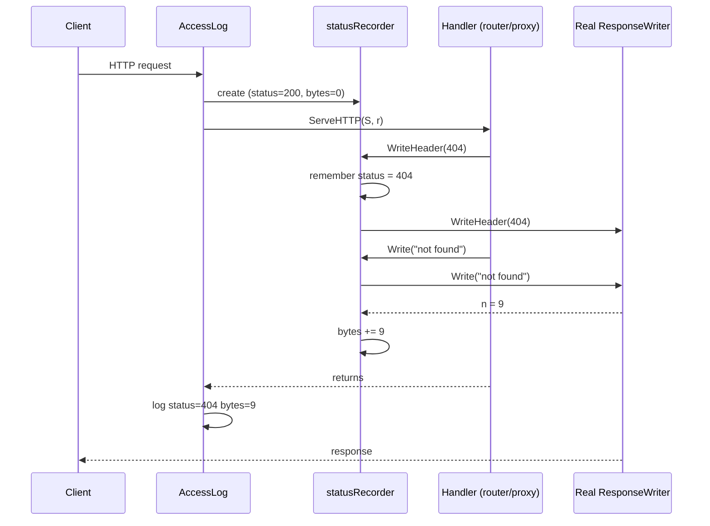

The handler has no idea it is talking to a spy, because `statusRecorder`
satisfies the same `ResponseWriter` interface.

#### How it is built

```go
type statusRecorder struct {
    http.ResponseWriter   // embedded: the real writer
    status      int       // starts at 200
    bytes       int
    wroteHeader bool
}
```

Embedding `http.ResponseWriter` is Go's shortcut for "delegate everything to
this field". `Header()` is promoted automatically, so I never write it. I only
write the methods where I want to do extra work, which are the spy points.

| Method | What it does | Why it is written that way |
| --- | --- | --- |
| `WriteHeader(code)` | Records the status, then calls the real one. | Only the **first** call counts, because net/http ignores later ones ("superfluous WriteHeader"). If I recorded every call, my log could disagree with what the client got. |
| | Ignores 1xx codes (except 101). | `103 Early Hints` is informational and not the final answer. A final status still follows. `101 Switching Protocols` IS final (WebSocket handoff). |
| `Write(b)` | Sets `wroteHeader`, calls the real `Write`, adds the returned `n` to `bytes`. | A `Write` with no earlier `WriteHeader` makes net/http send an implicit `200`, so `status` defaults to 200 and I only need to lock it in. I add `n` and not `len(b)` because a write can be partial or fail. |
| `Flush()` | Marks the header as written, then flushes the real writer. | Flushing pushes buffered data to the client (needed for SSE). It also commits headers with an implicit 200, same as `Write`. |
| `Hijack()` | Takes over the raw TCP connection, and records 101. | After a hijack net/http stops managing the response (WebSockets, `Upgrade`). I record 101 because that is what the connection became. |
| `Unwrap()` | Returns the real writer. | A map for `http.ResponseController` (see below). |

The status code's life inside the recorder:

```mermaid
stateDiagram-v2
    [*] --> Default: created, status = 200
    Default --> Locked: WriteHeader(final code)
    Default --> Locked: Write() or Flush(), implicit 200
    Default --> Default: WriteHeader(1xx), pass through, not recorded
    Locked --> Locked: later WriteHeader or Write, status unchanged
    Locked --> [*]: AccessLog reads status and bytes
```

#### Why `Flush`, `Hijack` and `Unwrap` exist at all: hidden interfaces

This is the hard part. A `ResponseWriter` in net/http is more than the
three-method interface. The real server's writer also has **optional**
capabilities, and callers discover them with a type assertion:

```go
if f, ok := w.(http.Flusher); ok { f.Flush() }     // streaming / SSE
if h, ok := w.(http.Hijacker); ok { h.Hijack() }   // WebSockets, Upgrade
```

When I embed the `http.ResponseWriter` **interface**, only its three methods
are promoted. `Flush` and `Hijack` are not part of that interface, so my wrapper
does not have them even though the object inside does. The wrapper
**hides** them:

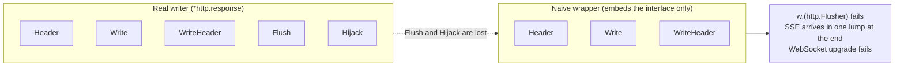

Symptoms of this bug are nasty because **nothing crashes**. The proxy still
works for normal JSON, and only streaming or upgraded connections break, often
only in production. That is why the M3 self-check asks about it.

There are two fixes, and I use both:

1. **Delegate by hand**: write `Flush()` and `Hijack()` on the recorder that
   forward to the real writer. This keeps old-style `w.(http.Flusher)`
   assertions working.
2. **`Unwrap() http.ResponseWriter`** (Go 1.20+): a convention, not a
   requirement of the interface. `http.NewResponseController(w)` is the modern
   way to call optional features. It first tries the method directly on `w`,
   and if that is missing it calls `Unwrap()` and tries again, peeling wrappers
   like an onion until it finds one that supports it.

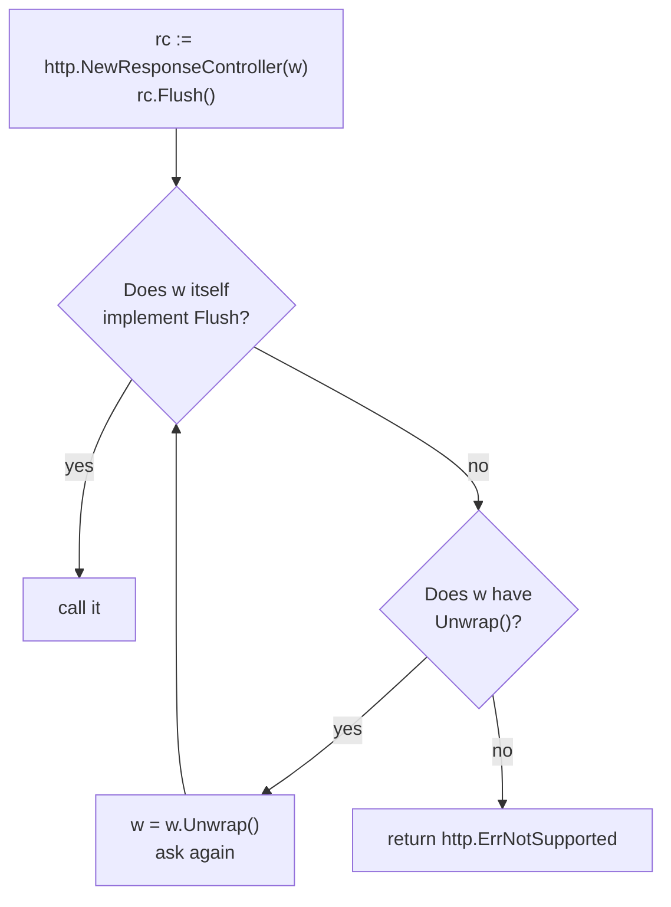

Because of this, even a wrapper with only `Unwrap` would work for code that uses
`ResponseController`. `httputil.ReverseProxy` does, which is why my proxy
streams correctly. My explicit `Flush`/`Hijack` are a belt-and-braces measure
for older code that still does `w.(http.Flusher)`. Note my `Flush` calls
`http.NewResponseController(r.ResponseWriter).Flush()` so that it also works if
another wrapper sits underneath mine.

#### Where it sits in the gateway

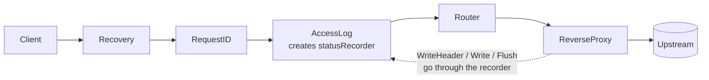

Everything below AccessLog sees the recorder as "the writer". Everything above
it (Recovery) sees the real one. Headers set by RequestID before
`next.ServeHTTP` still reach the client because `Header()` is promoted straight
to the real writer. One consequence: AccessLog logs after `next.ServeHTTP`
returns and does not use `defer`, so a panic below it skips the log line.
Recovery (outside) then writes the 500 to the real writer, which the recorder
never sees.

#### Gotchas I should remember

- **The recorder reports what the handler *tried* to send**, not what the client
  received. If the client disconnects, `Write` returns an error and I only count
  the `n` that succeeded.
- **One recorder per request.** It holds mutable state and is not goroutine-safe.
  It is created inside the handler, never shared between requests.
- **Pointer receivers** (`*statusRecorder`) are required, otherwise the methods
  would update a copy and the log would always say 200 / 0 bytes.
- **Other hidden interfaces exist**: `io.ReaderFrom` (a fast path for `io.Copy`)
  and `http.Pusher` (HTTP/2 push). The wrapper hides them too. For
  `ReaderFrom` that is only a small performance loss, because `io.Copy` falls
  back to a normal loop. I did not add them since nothing in the gateway needs them.
- **Testing it**: `statusrecorder_test.go` checks the status/bytes rules, that
  `Flush` reaches the real writer (also through `ResponseController`), and that
  `Hijack` does too. Those tests are the safety net against the silent breakage above.

**30-second version:** `ResponseWriter` is write-only, so to log the status I
wrap it in a spy that records the first `WriteHeader`/`Write` and forwards
everything. The catch is that embedding the interface hides optional
capabilities like `Flush` and `Hijack`, so the spy must forward them (or expose
`Unwrap`) or SSE and WebSockets silently break.

---

## M4 — Timeouts, context and the Transport   (done 2026-10-26)

What I built:
- `config.Server` got `read_timeout`, `write_timeout` and `max_header_bytes`, with
  non-zero defaults in `applyDefaults`. All four `http.Server` timeouts and
  `MaxHeaderBytes` are set on the server in `cmd/gateway`.
- `Validate` rejects a config where `write_timeout` is not greater than the
  largest route `timeout` (zero means "no write deadline", so no check). The
  error names the route. Four table cases pin it down.
- `middleware.Timeout(d)`: `context.WithTimeout(r.Context(), d)`, `defer cancel()`,
  then `next.ServeHTTP`. It is applied PER ROUTE when the handlers are built in
  `main.go`, not in the global chain (see "what broke" below).
- `proxy.NewTransport(opts)`: one shared Transport cloned from the default one,
  with `DialContext` timeout, TLS and response-header timeouts, `MaxIdleConns`,
  `MaxIdleConnsPerHost` (100, not the stdlib 2) and `IdleConnTimeout`. The values
  live in `DefaultTransportOptions()`; each override is explained in a comment.
- `errorHandler` maps errors with `errors.Is`: `DeadlineExceeded` and any
  `net.Error` with `Timeout()` -> 504 (`timeout` JSON code), `Canceled` -> logged,
  everything else -> 502.
- `cmd/toysvc` now sets `ReadHeaderTimeout` 5s and `IdleTimeout` 60s (longer than
  the gateway's 30s `IdleConnTimeout`).
- Tests: middleware (next called, deadline set, expiry, shorter parent wins),
  error-handler table, end-to-end 504 through a slow `httptest` upstream,
  `ResponseHeaderTimeout` -> 504, client cancel aborts the upstream, Transport
  options applied, `httptrace` proof of connection reuse, header forwarding
  (`TestProxyForwardsHeaders`), the `write_timeout` validation cases, and the
  slow-client upload (408) tests.

What broke during the "break it" experiment, and why:
- Ran the two experiments from the spec, scripted in `scripts/m4-experiments.sh`
  and `scripts/m4-timewait.sh` (both restore the repo and the lab on exit).
  Measured results are in "Break-it results" below. Side cases 1-6 and 8-10 in
  the table further down are still PREDICTIONS; only case 7 was measured.
  Bugs I hit while building, found in review and by tests:
  - `Timeout()` first version never called `next.ServeHTTP`, so every request
    returned an empty 200 and the route was never reached. No test existed.
  - The first design tried to hand the route's timeout to a middleware that runs
    BEFORE the router, with `context.WithValue`. Values only flow downward, so
    the middleware could never see it (same reason `routeHolder` exists). The fix
    was to stop passing it through context at all: the timeout is known from
    config at startup, so wrap each route's handler with it.
  - Two `const x ctxKey = iota + 1` in separate declarations are both `1`, the
    same type and value, so they were the SAME context key.
  - `TransportOptions{}` overwrote every sane default with zero (no timeouts, idle
    conns never evicted). Zero in a Transport field usually means "unlimited".
  - `MaxConnsPerHost` set instead of `MaxIdleConnsPerHost`: a hard cap on total
    connections instead of the idle pool size, so the default of 2 stayed.
  - The `net.Error` timeout branch in `errorHandler` was empty, so a dial or
    response-header timeout answered with an empty 200.
  - `max_header_bytes: 1` in the YAML would have rejected every request. The
    config test only checked that the file loads.
  - Measured (case 7): a client that stalls mid-upload past `ReadTimeout` got a
    504, not the 502 or closed connection I predicted. The failing read was on
    the CLIENT's connection, but it is a `net.Error` timeout, so `errorHandler`
    blamed the upstream (and would have fed a wrong failure into the circuit
    breaker in M8). Fixed: see "Fix for case 7" below.

### Break-it results (measured 2026-10-26)

**A. Slow upstream: why a timeout protects the whole gateway.** orders at
`-latency=60s`, gateway limited to 256 file descriptors (tiny `ulimit -n`),
50 requests/second for 30s at `/api/orders/1`, while probing the HEALTHY
`/api/products/1` route. Script: `scripts/m4-experiments.sh` (vegeta, open loop).

| | route timeout 1h (effectively none) | route timeout 1s |
| --- | --- | --- |
| Connections held to orders | 124, stayed there | 50 |
| Healthy `products` route | `000` (no answer after 3s) | 200 in about 1 ms |
| "too many open files" log lines | 25 | 0 |
| Orders responses | none ever completed | 1500 of 1500 were 504, after about 1.00s |

With no timeout, every request holds a client fd and an upstream fd until the
upstream answers. 124 stuck requests used about 250 of the 256 descriptors, so the
gateway could not accept or serve ANY route. With a 1s timeout, in-flight requests
settle at rate x timeout = 50, about 100 descriptors, and the healthy route is
untouched.

What I got wrong first: my first run used `hey -c 300`, which is closed loop
(always 300 requests in flight), so the 1s timeout still starved the gateway
(about 1M "too many open files" lines, 998,767 responses of 502). A timeout caps
how long a request lives, not how many a closed-loop client keeps in flight.
Use a fixed-rate generator (vegeta) to model independent clients.

**B. `MaxIdleConnsPerHost` 2 vs 100 vs 200.** 20000 requests, 200 concurrent
clients, through the gateway to the fast products upstream. TIME_WAIT counted in the
gateway's network namespace, towards port 9003, with a fresh gateway container
(TIME_WAIT starts at 0) for every run. 5 runs per pool size. Scripts:
`scripts/m4-timewait.sh` (one run of 2 vs 100) and `scripts/m4-timewait-matrix.sh`, which ran the
5 x 3 matrix below.

| MaxIdleConnsPerHost | Requests/sec (5 runs) | Mean req/s | TIME_WAIT after a run | p99 |
| --- | --- | --- | --- | --- |
| 2 (stdlib default) | 14.8k to 16.1k | **15.5k** | about 13,300 | 64 to 79 ms |
| 100 (tuned) | 19.4k to 20.2k | **19.7k** | about 1,500 | 49 to 68 ms |
| 200 (= concurrency) | 25.1k to 28.1k | **26.7k** | about 25 to 200 | 58 to 82 ms |

Relative to the default: 100 is about +27% req/s with about 9x fewer TIME_WAIT
sockets; 200 is about +72% with about 100x fewer. The pool-2 and pool-100 req/s
ranges do not overlap, so the gap is real, not noise. p99 ranges overlap across
all three, so I draw no conclusion about tail latency from this data.

**What decides the result: does the request find an idle connection?**

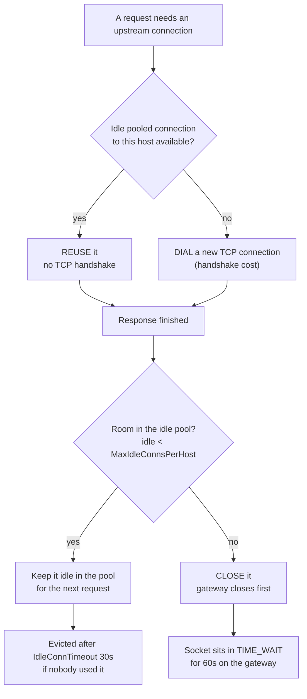

**Same burst of clients, pool of 2 versus a pool big enough** (3 clients shown
instead of 200; the pattern is the same):

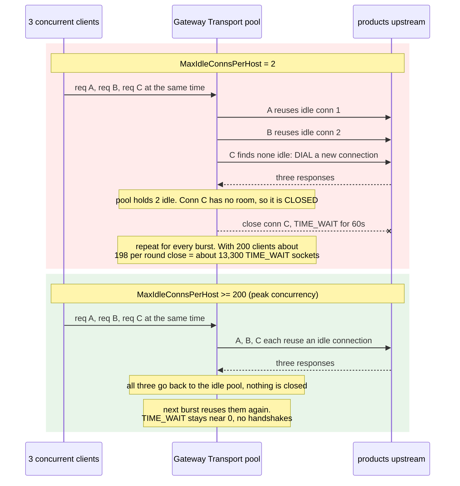

**Reading the numbers.**
- The pool size decides how often a request pays for a TCP handshake. With 200
  clients and a pool of 2, most requests dial a new connection and close it after,
  and the closing side (the gateway) holds the socket in TIME_WAIT for 60s.
  13,300 sockets for 20,000 requests means about two thirds of requests took that
  path.
- Throughput rises at every step (15.5k, 19.7k, 26.7k): the only change is
  reusing connections instead of re-dialing.
- At 100, half of the 200 clients still find no idle slot, which is the 1,500
  TIME_WAIT left. Rule: set the pool at least to the expected peak concurrency per
  upstream host.
- This is a best case. The upstream is local and answers in about 1 ms, so the
  handshake is cheap. Against a remote or TLS upstream each dial costs much more
  and reuse matters more.
- A bigger pool is not free: idle connections hold file descriptors on both sides
  until `IdleConnTimeout` (30s) evicts them. Size it to realistic peak
  concurrency, not infinity.

Self-check answers:
  1. Why is an unbounded upstream call dangerous for the gateway's health, not
     just the request? Every in-flight request holds a goroutine, a client
     connection and an upstream connection (two file descriptors). If an upstream
     stalls, requests keep arriving at the same rate while none finish, so
     goroutines and descriptors grow until the process hits `ulimit -n`. Then it
     cannot accept or serve anything, including routes with healthy upstreams.
     In-flight requests are roughly arrival rate times time held, and a timeout
     caps the second factor.
  2. Why must `write_timeout` be longer than every route timeout? `WriteTimeout`
     is a deadline on the socket that starts after the headers are read. If it
     passes before the route deadline, the 504 written by `errorHandler` fails
     and the client sees an empty reply instead of a clean error. The route
     context deadline is the real control; the server timeouts are a backstop.
  3. Why are there two different "timeout" error types? Our own context deadline
     comes back as `context.DeadlineExceeded`. Dial, TLS and `ResponseHeaderTimeout`
     are enforced inside the Transport and come back as a `net.Error` with
     `Timeout() == true`. Handling only the first would turn those into 502s.

Interview one-liner:
  Timeouts exist at three layers: the server's socket deadlines protect the
  gateway from bad clients and just close the connection, a per-route context
  deadline protects it from slow upstreams and produces a 504, and a tuned shared
  Transport bounds dialing and header waits while keeping connections pooled. The
  deadlines must nest: route timeout < ResponseHeaderTimeout < WriteTimeout, and
  the gateway's idle timeout must be shorter than the upstream's.

Open questions to bring to review:
- (Resolved) Client cancel now answers 499 `client_closed_request`, so AccessLog
  no longer counts a hang-up as an upstream error.
- Should a Transport timeout count as a failure for the circuit breaker (M8) the
  same way a context deadline does?
- Case 7 is fixed (408), but a slow upload that eats the whole ROUTE timeout
  (route 1s, client uploading slowly) still ends in a 504, because nothing was
  recorded yet when the deadline fired. Can I tell "client still uploading" from
  "upstream slow to read the body"? Probably not without more state.
- (Resolved) `server.response_header_timeout` is now a config field (default
  10s) and `Validate` rejects any route whose timeout exceeds it.

### Component map: who talks to whom, and which clock watches each hop

Interactive version (click a clock to see where it runs and what the client gets):
https://claude.ai/artifact/3j3UgM3LgfFGysWQdjQycs

**The key idea: one request uses TWO separate TCP connections.** The client talks
to the gateway on connection 1. The gateway talks to the upstream on connection 2,
which comes from a shared pool and is reused by other requests. Each connection has
its own clocks, and there is a third deadline (the route timeout) that lives in
the gateway's context, not on any socket.

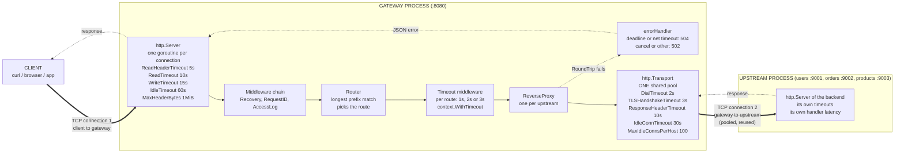

#### Life of one request, with every clock

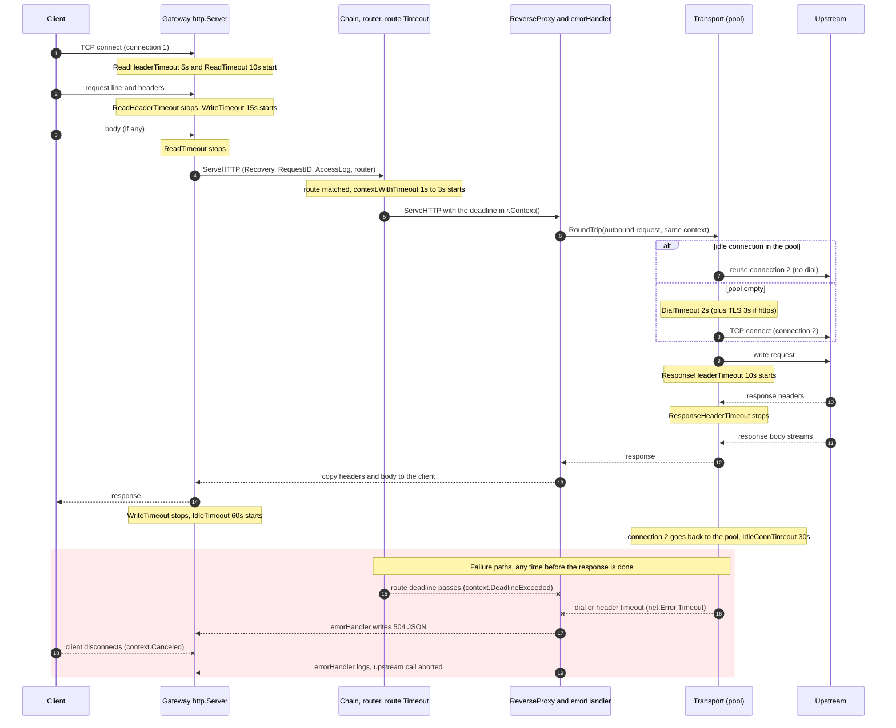

#### Where each deadline lives (the nesting)

```text
time ->  0s          1s         2s         3s                10s        15s            30s       60s
         |           |          |          |                  |          |              |         |
route    [products 1s][users 2s ][orders 3s]                  |          |              |         |   context deadline, fires FIRST
Dial     [--2s--]                                             |          |              |         |   connection 2, only on a new connection
RespHdr  |-----------------------------------------------------10s       |              |         |   connection 2, request written -> headers
Write    |------------------------------------------------------------------15s          |         |   connection 1, headers read -> response done
IdleConn                                                                                 30s------>|   connection 2, idle in the pool
Idle                                                                                              60s  connection 1 idle (and the upstream's own idle)

Rules:  route timeout  <  ResponseHeaderTimeout  <  WriteTimeout
        gateway IdleConnTimeout (30s)  <  upstream IdleTimeout (60s)
```

#### What fired, who notices, what the client gets

| Event | Detected by | Error seen | Client gets |
| --- | --- | --- | --- |
| `ReadHeaderTimeout` | http.Server (socket read deadline) | none, handler never runs | connection closed, no response |
| `ReadTimeout` | http.Server, while reading the body | body read returns `i/o timeout`, recorded by `clientBody` | **408** JSON, code `request_timeout`, `Connection: close` (was a wrong 504 before the case 7 fix) |
| `WriteTimeout` | http.Server, on the next write | write fails with `i/o timeout` | empty reply, the handler keeps running |
| `IdleTimeout` | http.Server | none | closed idle connection |
| Route timeout | context deadline -> `errorHandler` | `context.DeadlineExceeded` | **504** JSON, code `timeout` |
| `DialTimeout` | Transport -> `errorHandler` | `net.Error`, `Timeout()` true | **504** JSON |
| `TLSHandshakeTimeout` | Transport -> `errorHandler` | `net.Error`, `Timeout()` true | **504** JSON |
| `ResponseHeaderTimeout` | Transport -> `errorHandler` | `net.Error`, `Timeout()` true | **504** JSON |
| Connection refused / reset | Transport -> `errorHandler` | other error | **502** JSON, code `bad_gateway` |
| Client hangs up | http.Server cancels `r.Context()` | `context.Canceled` | nobody to answer; logged; upstream call aborted |
| `IdleConnTimeout` | Transport, in the pool | none | no request affected |

Three things that are easy to mix up:
- **Socket deadlines vs context deadlines.** The four `http.Server` timeouts are
  deadlines on connection 1's socket. They close it and can never produce an HTTP
  error. Only the context deadline and the Transport timeouts reach `errorHandler`
  and produce a clean 504/502.
- **Who owns the response body clock.** No Transport field limits a slow body after
  the headers arrive. Only the route's context deadline covers it, which is why
  both layers are needed.
- **Idle on both sides.** `IdleTimeout` (server, connection 1) and `IdleConnTimeout`
  (Transport, connection 2) are different clocks on different connections. The
  gateway's `IdleConnTimeout` must stay shorter than the upstream's idle timeout.

### Deep dive: how `http.Server` timeouts work, where each clock starts

**Rule 0: a timeout in `net/http` is a deadline on the TCP connection, not on
the handler.** The server calls `SetReadDeadline` / `SetWriteDeadline` on the
socket. When one passes, the next read or write on that socket fails with an
`i/o timeout`. Nothing cancels the handler goroutine, nothing writes a 408 or a
504 for me. This explains almost every side case below.

#### The four clocks on one connection

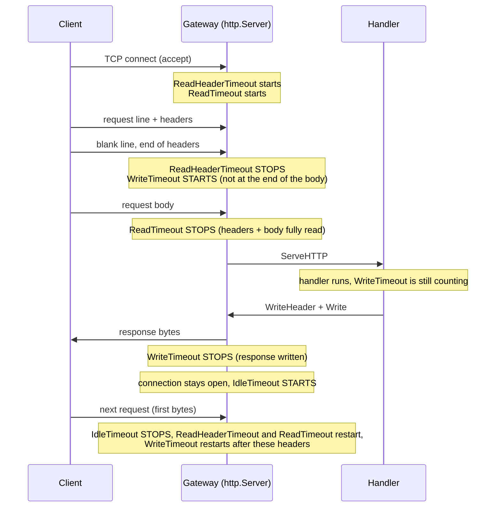

Same thing as a ruler (time flows right, one request on a fresh connection):

```text
accept     headers done        body done                response done      next request
  |             |                  |                          |                  |
  |-------------|                  |                          |                  |  ReadHeaderTimeout
  |------------------------------- |                          |                  |  ReadTimeout (headers + body)
  |             |-------------------------------------------- |                  |  WriteTimeout (starts at end of HEADERS)
  |             |                  |                          |------------------|  IdleTimeout
```

| Timeout | Starts | Stops | Protects against |
| --- | --- | --- | --- |
| `ReadHeaderTimeout` | connection accepted (first request), or first bytes of the next request on a keep-alive connection | blank line after the headers | Slowloris (headers dribbled byte by byte) |
| `ReadTimeout` | same moment as `ReadHeaderTimeout` | last body byte read | slow uploads, slow-body attacks |
| `WriteTimeout` | **end of the request headers**, not the end of the body | response fully written | clients that read the response too slowly, and handlers that take too long |
| `IdleTimeout` | response finished | first bytes of the next request | idle keep-alive connections piling up |

Gotchas about the clocks:
- `ReadHeaderTimeout == 0` falls back to `ReadTimeout`. `IdleTimeout == 0` also
  falls back to `ReadTimeout`. A zero is not always "no limit". If all of them
  are 0 there is no limit at all, which is the dangerous default.
- `WriteTimeout` starts after the HEADERS are read, so for a big upload the body
  read time is spent from the same budget as the handler and the response.
- `ReadTimeout` and `WriteTimeout` are per request, not per connection. They are
  re-armed for every request on a keep-alive connection.
- `WriteTimeout` includes the handler's whole run time, so it is really a budget
  for "everything the gateway does after reading the headers".

#### What happens when each one is exceeded

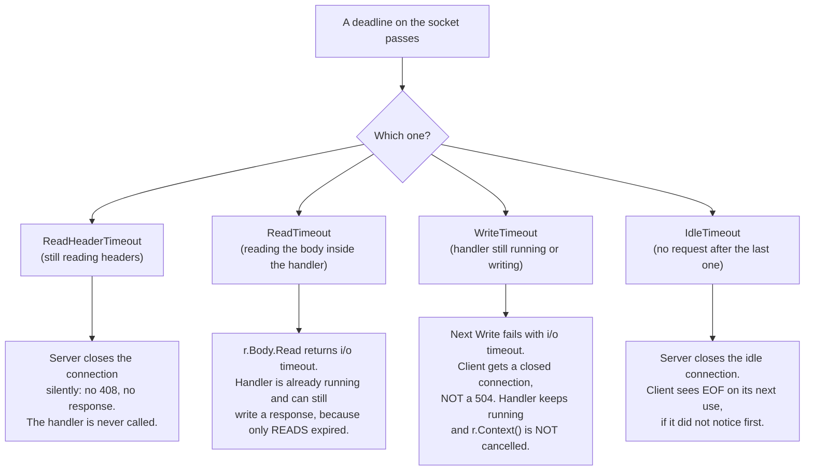

#### Side cases, with how to prove each one

Setup for these: gateway on `:8080`. For `/orders` use orders-svc with
`-latency 5s`. Change one config value at a time and restart. I only believe a
row after I have seen the output myself, so the "expect" column is a hypothesis.

| # | Case | How to provoke it | What I expect | Why |
| --- | --- | --- | --- | --- |
| 1 | Slowloris, `ReadHeaderTimeout: 5s` | `( printf 'GET /health HTTP/1.1\r\nHost: x\r\n'; sleep 10 ) \| nc localhost 8080` (never sends the blank line) | `nc` returns after about 5s with NO response bytes | Deadline passed before the headers were complete, so the server just closes. No 408. The handler never ran, so AccessLog prints nothing either. |
| 2 | Same as 1 with `ReadHeaderTimeout: 0` and `ReadTimeout: 0` | same command | `nc` hangs the full 10s and beyond, until I kill it | No clock exists. This is the vulnerable default. Do this in the "break it" run, then fix it. |
| 3 | `WriteTimeout` shorter than the route timeout | `write_timeout: 2s`, `/orders` route `timeout: 3s`, upstream `-latency 5s`, then `curl -i localhost:8080/api/orders/1` | curl fails with `Empty reply from server` (exit 52). No 504. | At t=2s the socket's write deadline passes. At t=3s my middleware cancels the context and ErrorHandler writes a 504, but that write fails (`i/o timeout`) and nothing reaches the client. |
| 4 | `WriteTimeout` longer than the route timeout | `write_timeout: 15s`, route `timeout: 1s`, same upstream | `HTTP/1.1 504` after about 1s | The 504 is written inside the write budget. This is the correct configuration. |
| 5 | Handler keeps running after `WriteTimeout` | case 3, watch orders-svc logs and the gateway goroutine count | Upstream request is only aborted at t=3s (route timeout), not at t=2s | `WriteTimeout` closes nothing by itself and cancels no context. The handler is only stopped by something that watches the context. This is why `WriteTimeout` is a backstop, and the route timeout is the real tool. |
| 6 | Client hangs up, no timeouts involved | `curl -m 1 localhost:8080/api/orders/1` (curl gives up at 1s) | Upstream sees the request abort at about 1s. Gateway logs "client closed" (context.Canceled), not an upstream error | The server notices the closed socket, cancels `r.Context()`, `ReverseProxy` passes that to the Transport, which aborts the upstream call. |
| 7 | Slow body upload, `ReadTimeout: 5s` | `curl -X POST -T - localhost:8080/api/orders` fed slowly: `( echo -n a; sleep 10; echo b ) \| curl -X POST --data-binary @- -H 'Transfer-Encoding: chunked' localhost:8080/api/orders` | **Measured** (scratch test, raw TCP client, `ReadTimeout` 300ms, body stalled 900ms): the client got `HTTP/1.1 504 Gateway Timeout`; the upstream saw 1 body byte, then `unexpected EOF`; the gateway logged `upstream timeout ... read tcp 127.0.0.1:...: i/o timeout`. I expected a 502 or a closed connection. | Headers were fine, so the handler started and only READS were dead, so the response write still worked. `ReverseProxy` failed reading the CLIENT's body. That error is a `net.Error` with `Timeout() == true`, so the branch meant for dial / `ResponseHeaderTimeout` mapped it to 504 and blamed the upstream. The slow side was the client. **Fixed**: `clientBody` records the failure and `errorHandler` answers 408 (see "Fix for case 7"). |
| 8 | `IdleTimeout: 2s`, reuse a connection | `curl localhost:8080/health --next --keepalive-time 1` is awkward, so use `nc`: send one request with `Connection: keep-alive`, `sleep 3`, send another on the same socket | The second request gets no response, `nc` sees the close | Server closed the idle connection at 2s. A real client's Transport retries idempotent requests when this happens, `nc` does not. |
| 9 | Gateway-to-upstream idle race | upstream `IdleTimeout: 2s`, gateway Transport `IdleConnTimeout: 90s`, send one request every ~2s with `hey -z 30s -q 0.5` | Sporadic 502s (`EOF` / `connection reset by peer`), roughly at the moment the upstream closes the connection | The gateway reuses a pooled connection at the same instant the upstream closes it. Rule: the gateway's `IdleConnTimeout` must be SHORTER than every upstream's `IdleTimeout`, so the gateway is the one that closes first. |
| 10 | `WriteTimeout` on a streaming route | route proxies an SSE endpoint, `write_timeout: 5s` | The stream is cut after 5s, every time | `WriteTimeout` covers the whole response, and a stream is one long response. Streaming routes (M-later: SSE/WebSocket) need a longer budget or per-request control with `http.NewResponseController(w).SetWriteDeadline(...)`. |

#### Who wins when two deadlines race (case 3 and 4)

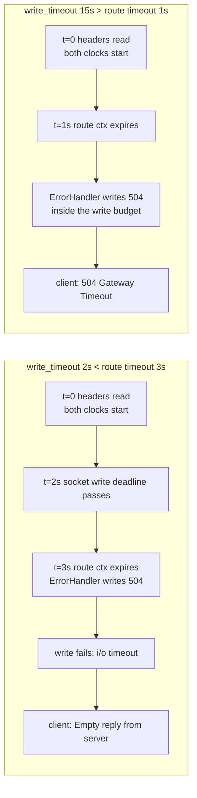

The invariant to enforce: `server.write_timeout > max(route.timeout) + margin`.
This is a cross-field rule between `Server` and `Route`, so it belongs in
`Validate`, where it can fail fast at startup. A bad combination silently turns
every 504 into a dropped connection, which is hard to debug from the outside.

#### The two timeout layers are different tools

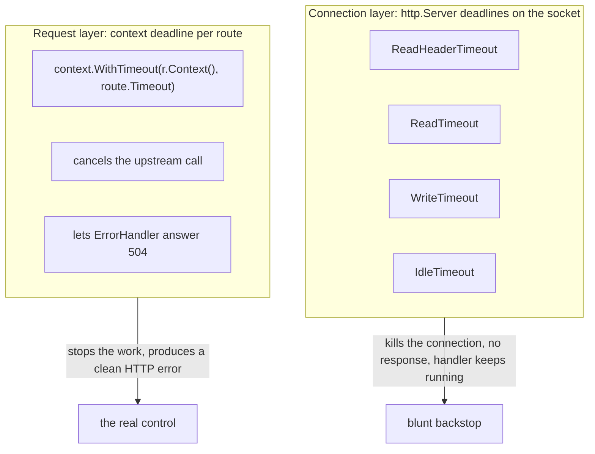

- Server timeouts protect the gateway from bad CLIENTS and from itself.
  They end connections, and they cannot produce an HTTP error response.
- The context deadline protects the gateway from bad UPSTREAMS. It stops the
  work and lets me answer with a proper 504.
- I need both, and the context deadline has to fire first (`route.timeout`
  shorter than `write_timeout`).

**30-second version:** each `http.Server` timeout is a deadline on the socket
that starts at a different point of the request (headers, body, end of headers
for the write clock, end of response for idle). When one passes, the connection
fails silently, with no 408 or 504, and the handler is not cancelled. So the
server timeouts are a backstop for bad clients, the per-route context deadline
is what produces a clean 504, and `write_timeout` must be longer than the
longest route timeout or the 504 never reaches the client.

### Note: do I still have to drain a response body before `Close()`?

Reference: [Go blog, "Better HTTP/1 connection reuse"](https://go.dev/blog/http-connection-reuse)
(Nicholas Husin and Damien Neil, 14 Oct 2026). It says this change landed in
**Go 1.27**, and my experiment and source reading below match it.

The old advice was: always `io.Copy(io.Discard, resp.Body)` before `resp.Body.Close()`,
or the connection is closed instead of going back to the pool. Through Go 1.26
that was true. From Go 1.27 it is no longer true for small bodies. I checked it on Go 1.27.1 (`go version`) in two ways:

- Reading `$GOROOT/src/net/http/transport.go`: `readLoop` calls `maybeDrainBody`
  when a body is closed unread. It reads and discards up to
  `maxPostCloseReadBytes` (256 KiB) and gives up after `maxPostCloseReadTime`
  (50 ms). It only tries when `resp.ContentLength <= 256 KiB` (chunked, with
  length -1, also tries). If it reaches EOF, the connection is reused.
- An experiment (two sequential requests, `httptrace` `GotConn.Reused`), closing
  WITHOUT reading:

  | Body | Reused on request 2 |
  | --- | --- |
  | 2 bytes, 4 KiB | yes |
  | 64 KiB, 256 KiB | usually (see the race below) |
  | 512 KiB, or 1 MiB (chunked or not) | no, the connection is closed |

What this means in practice:
- The drain is **asynchronous**. `Close()` returns right away and the transport's
  read loop drains in the background. A second request started immediately can
  find the connection not yet back in the pool and dial a new one. With a 20 ms
  pause the 256 KiB case was reused, without it the result flipped between runs.
  An explicit read before `Close()` makes the connection available as soon as
  `Close()` returns, so it is still the deterministic choice when a test or a
  hot path depends on reuse.
- Above 256 KiB, or when the drain takes over 50 ms (slow upstream), the
  connection is closed no matter what. Draining a huge body just to save a
  connection is not worth it either, so closing is the right answer there.
- `TestTransportReusesConnections` therefore no longer drains: its body is two
  bytes. I ran it 100 times with `-race` and it passed every time.
- In the gateway itself this doesn't matter: `ReverseProxy` copies the whole
  upstream body to the client, so it reaches EOF and the connection goes back to
  the pool normally. It matters for code that ignores the body (health checks
  in M7, for example). There, read-and-discard, or limit it with `io.LimitReader`.

What the article adds to my own findings:
- **Why only HTTP/1.** HTTP/1 sends responses back-to-back on one byte stream, so
  the next response can't be reached until the current body is consumed.
  HTTP/2 multiplexes streams, so an unread body blocks nothing and there is
  nothing to drain. Don't drain HTTP/2 bodies by hand.
- **Skipped when `Connection: close`.** The Transport doesn't drain then, since
  the connection won't be reused anyway.
- **Silent degradation to watch for.** An API returning a body the caller
  ignores, or a decoder that stops short of the end (`json.Decoder` stops at the
  closing `}` and leaves the trailing newline unread). Before Go 1.27 both
  quietly cost a new TCP (and TLS) connection per request.
- **Their benchmark:** 100 status-only GETs with HTTP/1 forced
  (`GODEBUG=http2client=0`): about 710 ms on Go 1.26 vs 150 ms on Go 1.27.
- **Recommendation:** just `defer resp.Body.Close()`. The article also warns the
  draining behavior may change in future releases, so don't build code that
  depends on its exact limits.
- It says the Transport drains **asynchronously**, which fits the race I saw:
  a request started right after `Close()` can beat the drain and dial anew.

### Fix for case 7: a slow CLIENT must not be reported as a slow UPSTREAM

**Problem (measured).** A client that stalls mid-upload past `ReadTimeout` got a
504. `ReverseProxy` copies the client's body to the upstream, so the failing read
was on connection 1, but the error is a `net.Error` with `Timeout() == true`, the
same shape as a dial timeout. `errorHandler` could not tell the two apart.

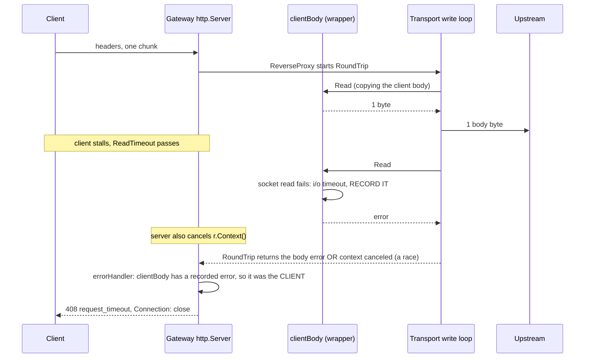

**What changed.**
- `internal/proxy/clientbody.go`: `clientBody` wraps the outbound request body
  (set in `Rewrite`) and records the FIRST non-EOF read error. It is an
  `atomic.Pointer`, because the Transport's write goroutine writes it and the
  handler goroutine reads it after `RoundTrip` returns (the race detector would
  flag a plain field).
- `errorHandler` checks it first. If the client body recorded a failure and the
  reported error is that same error or `context.Canceled`: a `net.Error` timeout
  becomes **408** `request_timeout`, any other failure (client vanished,
  `unexpected EOF`) becomes **400** `bad_request`. Both send `Connection: close`
  because the rest of the body was never read.
- `http.ErrBodyReadAfterClose` is never recorded. It means the Transport already
  gave up (for example connection refused) and closed the body, so blaming the
  client for it would be wrong.

**Why `context.Canceled` is accepted too.** My first version required
`errors.Is(err, recordedError)`. The unit tests passed and the end-to-end test
failed with a 502. Printing both errors showed why: when the read deadline fires,
`http.Server` also cancels `r.Context()`, and `RoundTrip` can report that
cancellation instead of the body error. Which one wins is a race. The unit tests
used the happy shape of the error and never saw it; only the real server did.

**Tests.** `TestErrorHandlerClientBodyFailure` (6 cases: stalled client, error
wrapped by the Transport, canceled context, vanished client, a healthy body still
gives 504, an unrelated error still gives 502), `TestClientBodyIgnoresReadAfterClose`,
and `TestSlowClientUploadReturns408` (a raw TCP client against a real
`http.Server` with a 200ms `ReadTimeout`, repeated 30 times under `-race`).

**Known gap.** If a slow upload eats the whole route timeout (say route 1s and the
client needs 5s to upload), the deadline fires first and nothing was recorded, so
the client still gets a 504. The other cause, an upstream that is slow to read the
body, looks identical from here, so I did not guess.
