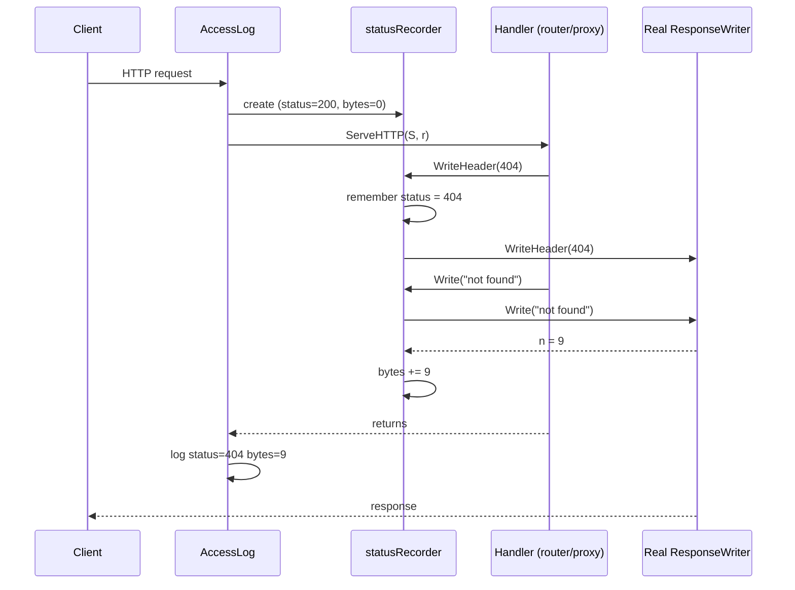
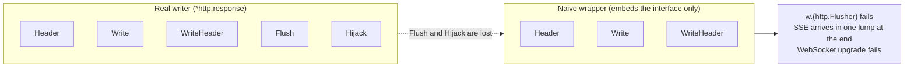
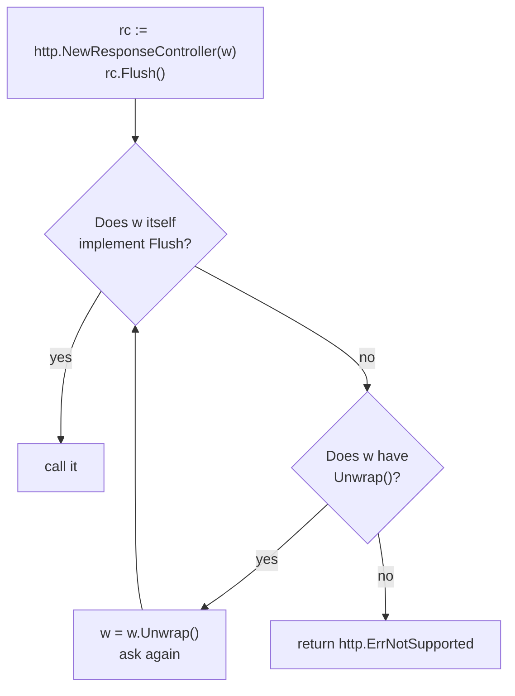
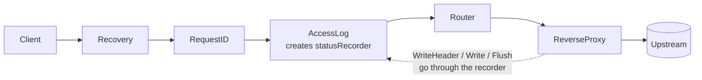

# Learning journal

One entry per milestone, written in your own words, without looking at notes.
If you can't explain it here, you're not done with the milestone yet.

Template:

```text
## Mx — <title>   (date finished)

What I built:
What broke during the "break it" experiment, and why:
Self-check answers (2–3 sentences each):
  1.
  2.
Interview one-liner (how I'd explain this concept in 30 seconds):
Open questions to bring to review:
```

---

## M0 — Toy backends and lab

What I built:

What broke, and why:

Self-check answers:

Interview one-liner:

Open questions:

---

## M2 — Config-driven routing   (2026-10-17)

What I built:
- `internal/config`: loads `configs/routes.yaml` with yaml.v3 in strict mode
  (`KnownFields(true)`), applies defaults, then validates everything and reports
  ALL problems at once with `errors.Join`. Checks: unknown upstream, duplicate
  prefix / route name, bad instance URLs (scheme + host), prefix must start with
  `/` and not end with `/`, valid methods, proxy routes need an upstream and
  aggregate routes must not have one. A bad file stops startup (fail fast).
- `internal/router`: longest-prefix match on path-segment boundaries
  (`path == prefix || HasPrefix(path, prefix+"/")`), routes sorted by prefix
  length so config order never matters. Optional `strip_prefix`
  (`/api/users` -> `/`, `/api/users/42` -> `/42`). 404 when nothing matches,
  405 + `Allow` header when the prefix matches but the method doesn't (typed
  error `MethodNotAllowedError` that also satisfies `errors.Is(ErrMethodNotAllowed)`).
- `cmd/gateway/main.go`: one `ReverseProxy` per UPSTREAM, built once at startup
  and shared by every route that points at it (not one per route, not one per
  request). All proxies share one Transport.
- Tests: table-driven router tests, config validation tests, and an end-to-end
  test with `httptest` fake upstreams that checks what the upstream really received.

What broke during the "break it" experiment, and why:
- Routes `/api/user` and `/api/users`: `/api/users/1` goes to `/api/users`
  because the longest prefix wins; `/api/username` does NOT match `/api/user`
  because `username` isn't a whole segment. A plain `HasPrefix` would have sent
  `/api/username` to the `/api/user` route.
- Found in review: I reset `RawPath = ""` after rewriting the path, so
  `/api/users/a%2Fb` reached the upstream as `/a/b`. The decoded `Path` can't tell
  a `/` separator from `%2F` data; only `RawPath` remembers. Fixed by matching and
  stripping on the escaped path and setting `Path` and `RawPath` together.
- Found in review: `/api/products/../users/1` matched `products` but the upstream
  could resolve it to another path. Dot-segments now get a 400, and an encoded
  prefix like `/api/%75sers` doesn't match (404, fail closed).
- Found in review: yaml.Unmarshal ignored unknown keys, so a typo like
  `strip_prefx` silently disabled the feature. `KnownFields(true)` makes it an error.

Deep dive: why rewriting a path can silently change its meaning
  - `/` vs `%2F`: in `/files/q3%2Freport` the slash is DATA (one segment, a file
    named `q3/report`). In `/files/q3/report` it is a SEPARATOR (folder `q3`
    containing `report`). Same characters once decoded, different meaning.
  - Go keeps two fields because of this. For `GET /api/users/a%2Fb`:
        Path    = "/api/users/a/b"     decoded, good for matching
        RawPath = "/api/users/a%2Fb"   original encoding, only set when it
                                       differs from the default encoding of Path
    `Path` alone can't tell me whether a slash was `/` or `%2F`.
  - How my gateway broke it (strip_prefix on `/api/users/a%2Fb`):
        client sends          /api/users/a%2Fb
        gateway rewrites      Path="/a/b", RawPath=""     <- encoding hint dropped
        proxy writes          EscapedPath() -> "/a/b"     (builds it from Path)
        upstream receives     /a/b                        but the client sent /a%2Fb
    The reverse proxy did nothing wrong. It encoded what I left it. The bug was
    my rewrite. It also hit routes with strip_prefix false, because I reset
    RawPath unconditionally.
  - Impact: an upstream route `GET /files/{name}` sees two segments instead of
    one, so it returns 404 or reaches a different handler. Worse, if the gateway
    decides auth or routing on one reading of the path and the upstream acts on
    another, that mismatch is security-relevant (same family as `..`).
  - The invariant to keep: after any rewrite, Path and RawPath must describe the
    SAME path. Strip the prefix from the escaped path, then derive Path with
    `url.PathUnescape`.
  - The design decision this forces: match on decoded or escaped form? Matching
    decoded lets `/api/%75sers/1` hit `/api/users` while stripping the escaped
    form would not find the prefix. Options: reject encoded `/` and `\` with 400,
    or match and forward escaped paths consistently. I chose the second: match
    and strip on `EscapedPath()`, so an encoded prefix fails closed (404), and
    reject dot-segments with 400.
  - Why my old tests missed it: `/api/users/42` decodes and re-encodes to the
    same string. The fake upstream must record `r.RequestURI` (raw request
    line), NOT `r.URL.Path`, which is already decoded and hides the difference.
    I ran the new tests against the old code first and watched them fail.
  - Rule of thumb: whenever a proxy changes a path, don't treat decoded `Path`
    as the whole request. Preserve the encoded form or normalize it on purpose.

Self-check answers:
  1. Why should `/api/username` not match the prefix `/api/user`? A prefix is a
     list of path segments, not a string prefix. `/api/user` means "the `user`
     resource and anything under it", and `username` is a different resource.
     Matching raw strings would route requests to the wrong service, and once
     auth exists, to the wrong auth policy. I enforce the boundary by requiring
     the path to equal the prefix or to start with prefix + "/".
  2. Why 405 and not fall through to a shorter prefix? The longest matching prefix
     owns that part of the URL space. If it exists but doesn't allow the method,
     the honest answer is "this resource exists, wrong method". Falling through
     would let a broad route like `/api` accept a method the specific route
     deliberately forbids.
  3. Why one proxy per upstream? The upstream is the unit that owns state (later:
     balancer, health, circuit breaker, bulkhead). Two routes to the same upstream
     must share one breaker, otherwise each counts only half the failures. It
     also means the proxy is built once at startup, never per request.

Interview one-liner:
  The gateway loads and validates a route table at startup, and for each request
  picks the route with the longest matching path prefix on segment boundaries. It
  returns 404 or 405 itself and otherwise hands the request to a reverse proxy
  that was built once per upstream. Config is the contract, so any mistake in it
  stops the gateway from starting.

Open questions to bring to review:
- Should defaults (timeouts, auth) live in `applyDefaults`, or should a missing
  timeout be a validation error? I chose defaults, but a silent 5s default may
  hide a forgotten setting.
- Reject `%2F` outright (400) versus preserving it? I preserve it, but is that the
  safer default for a public gateway?
- Prefixes with characters that need escaping can never match now. Should
  `Validate` reject them?
- Aggregate routes (M9) have no upstream, so `proxies[route.Upstream]` is nil.
  Where should that case be handled, in `main.go` or in `router.New`?

---

## M3 — Middleware chain   (2026-10-18)

What I built:
- `Middleware` is `func(http.Handler) http.Handler`. `Chain(h, mws...)` wraps so
  the FIRST middleware listed is the outermost (onion model); `chain_test.go`
  records the call order to prove it.
- `Recovery`: `defer` + `recover()` turns a panic into a JSON 500 and logs the
  stack. It re-panics `http.ErrAbortHandler`, which is a deliberate abort, not a bug.
- `RequestID`: reuses an incoming `X-Request-ID` only if it passes validation
  (length/charset, since it ends up in logs), otherwise generates a UUID. It is
  stored in the context under an unexported key type, set on the request (the
  proxy forwards it upstream) and on the response header.
- `AccessLog` (`log/slog`): one line after the request with method, path, route
  name, status, bytes, duration, request ID. The router doesn't run until
  inside AccessLog, so AccessLog puts a "route holder" in the context and the
  router fills in the matched route name for it to read afterwards.
- `statusRecorder` wraps `ResponseWriter` to capture status/bytes. Only the first
  `WriteHeader` counts, 1xx codes are ignored (except 101), and it implements
  `Flush`, `Hijack` and `Unwrap` so streaming and WebSockets survive the wrapper.
- Order in `cmd/gateway`: Recovery -> RequestID -> AccessLog -> router.
- Fix after review: Recovery sits outside RequestID, so its `r` has no ID in the
  context. It now falls back to the `X-Request-ID` response header (already set
  by RequestID on the same writer) for the 500 body and the panic log.

What broke during the "break it" experiment, and why:
- Ran it with `httptest.NewServer`, a middleware that panics, and Recovery
  placed on either side of it:
    Recovery outermost: client gets `500` with the JSON error body.
    Recovery innermost: the panic happens outside it, so nothing recovers it.
    net/http's per-connection goroutine catches it, logs it, and closes the
    socket. The client gets no HTTP response at all (`EOF`), and AccessLog
    never prints a line because its code after `next.ServeHTTP` never runs.
- So Recovery must be outermost: it can only catch panics from code it wraps.
  Anything outside it is unprotected, and a gateway shouldn't drop connections.

Self-check answers (2–3 sentences each):
  1. Why a custom key type instead of a `string` in `context.WithValue`?
     Context keys compare by type AND value. My `ctxKey` is unexported, so
     `ctxKey(0)` can never equal a key made by another package, even one using
     the same number or the string "request_id". No other package can collide
     with it, overwrite it, or forge a request ID.
  2. What happens to SSE if the recorder hides `Flush()`?
     Embedding `http.ResponseWriter` only promotes the interface's methods, not
     optional ones like `Flush`, so `w.(http.Flusher)` fails. ReverseProxy then
     can't flush each event, and the client sees them in batches or only when the
     response ends, so the stream looks hung. `Flush` + `Unwrap` fix it, and the
     same applies to `Hijack` for WebSockets.

Interview one-liner:
  Middleware is a function that takes a handler and returns a handler, so
  cross-cutting concerns (recovery, request ID, logging) stack like onion
  layers. Order is semantics: Recovery goes outermost so it catches everything,
  RequestID goes before AccessLog so the log has an ID, and any ResponseWriter
  wrapper must forward Flush/Hijack/Unwrap or it breaks streaming.

Open questions to bring to review:
- Recovery's 500 reads the ID from the response header. Is that the cleanest
  approach, or should RequestID store it somewhere Recovery can reach?
- When M5/M6 add auth and rate limiting inside AccessLog, should a request
  rejected there still get a route name in the log?
- If a handler panics after it already started writing the response, Recovery's
  500 can't change the status. Should it detect that and just abort the connection?

### Deep dive: `statusRecorder`, explained for a junior backend dev

**The problem.** After a request finishes, AccessLog wants to log "status 200,
1234 bytes". But `http.ResponseWriter` is write-only. It has exactly three methods:

```go
type ResponseWriter interface {
    Header() http.Header
    Write([]byte) (int, error)   // send body bytes
    WriteHeader(statusCode int)  // send the status line + headers
}
```

There is no `Status()` and no `BytesWritten()`. Once the handler calls
`WriteHeader(404)`, the number goes onto the wire and nobody keeps a copy.
The downstream handler (router, proxy) is the one calling these methods, and
AccessLog is the one that wants to know what happened.

**The trick: a spy in the middle.** AccessLog hands the next handler a fake
`ResponseWriter` that remembers what passes through and then forwards
everything to the real one. This is the decorator pattern again, applied to the
writer instead of the handler.



The handler has no idea it is talking to a spy, because `statusRecorder`
satisfies the same `ResponseWriter` interface.

#### How it is built

```go
type statusRecorder struct {
    http.ResponseWriter   // embedded: the real writer
    status      int       // starts at 200
    bytes       int
    wroteHeader bool
}
```

Embedding `http.ResponseWriter` is Go's shortcut for "delegate everything to
this field". `Header()` is promoted automatically, so I never write it. I only
write the methods where I want to do extra work, which are the spy points.

| Method | What it does | Why it is written that way |
| --- | --- | --- |
| `WriteHeader(code)` | Records the status, then calls the real one. | Only the **first** call counts, because net/http ignores later ones ("superfluous WriteHeader"). If I recorded every call, my log could disagree with what the client got. |
| | Ignores 1xx codes (except 101). | `103 Early Hints` is informational and not the final answer. A final status still follows. `101 Switching Protocols` IS final (WebSocket handoff). |
| `Write(b)` | Sets `wroteHeader`, calls the real `Write`, adds the returned `n` to `bytes`. | A `Write` with no earlier `WriteHeader` makes net/http send an implicit `200`, so `status` defaults to 200 and I only need to lock it in. I add `n` and not `len(b)` because a write can be partial or fail. |
| `Flush()` | Marks the header as written, then flushes the real writer. | Flushing pushes buffered data to the client (needed for SSE). It also commits headers with an implicit 200, same as `Write`. |
| `Hijack()` | Takes over the raw TCP connection, and records 101. | After a hijack net/http stops managing the response (WebSockets, `Upgrade`). I record 101 because that is what the connection became. |
| `Unwrap()` | Returns the real writer. | A map for `http.ResponseController` (see below). |

The status code's life inside the recorder:

```mermaid
stateDiagram-v2
    [*] --> Default: created, status = 200
    Default --> Locked: WriteHeader(final code)
    Default --> Locked: Write() or Flush(), implicit 200
    Default --> Default: WriteHeader(1xx), pass through, not recorded
    Locked --> Locked: later WriteHeader or Write, status unchanged
    Locked --> [*]: AccessLog reads status and bytes
```

#### Why `Flush`, `Hijack` and `Unwrap` exist at all: hidden interfaces

This is the hard part. A `ResponseWriter` in net/http is more than the
three-method interface. The real server's writer also has **optional**
capabilities, and callers discover them with a type assertion:

```go
if f, ok := w.(http.Flusher); ok { f.Flush() }     // streaming / SSE
if h, ok := w.(http.Hijacker); ok { h.Hijack() }   // WebSockets, Upgrade
```

When I embed the `http.ResponseWriter` **interface**, only its three methods
are promoted. `Flush` and `Hijack` are not part of that interface, so my wrapper
does not have them even though the object inside does. The wrapper
**hides** them:



Symptoms of this bug are nasty because **nothing crashes**. The proxy still
works for normal JSON, and only streaming or upgraded connections break, often
only in production. That is why the M3 self-check asks about it.

There are two fixes, and I use both:

1. **Delegate by hand**: write `Flush()` and `Hijack()` on the recorder that
   forward to the real writer. This keeps old-style `w.(http.Flusher)`
   assertions working.
2. **`Unwrap() http.ResponseWriter`** (Go 1.20+): a convention, not a
   requirement of the interface. `http.NewResponseController(w)` is the modern
   way to call optional features. It first tries the method directly on `w`,
   and if that is missing it calls `Unwrap()` and tries again, peeling wrappers
   like an onion until it finds one that supports it.



Because of this, even a wrapper with only `Unwrap` would work for code that uses
`ResponseController`. `httputil.ReverseProxy` does, which is why my proxy
streams correctly. My explicit `Flush`/`Hijack` are a belt-and-braces measure
for older code that still does `w.(http.Flusher)`. Note my `Flush` calls
`http.NewResponseController(r.ResponseWriter).Flush()` so that it also works if
another wrapper sits underneath mine.

#### Where it sits in the gateway



Everything below AccessLog sees the recorder as "the writer". Everything above
it (Recovery) sees the real one. Headers set by RequestID before
`next.ServeHTTP` still reach the client because `Header()` is promoted straight
to the real writer. One consequence: AccessLog logs after `next.ServeHTTP`
returns and does not use `defer`, so a panic below it skips the log line.
Recovery (outside) then writes the 500 to the real writer, which the recorder
never sees.

#### Gotchas I should remember

- **The recorder reports what the handler *tried* to send**, not what the client
  received. If the client disconnects, `Write` returns an error and I only count
  the `n` that succeeded.
- **One recorder per request.** It holds mutable state and is not goroutine-safe.
  It is created inside the handler, never shared between requests.
- **Pointer receivers** (`*statusRecorder`) are required, otherwise the methods
  would update a copy and the log would always say 200 / 0 bytes.
- **Other hidden interfaces exist**: `io.ReaderFrom` (a fast path for `io.Copy`)
  and `http.Pusher` (HTTP/2 push). The wrapper hides them too. For
  `ReaderFrom` that is only a small performance loss, because `io.Copy` falls
  back to a normal loop. I did not add them since nothing in the gateway needs them.
- **Testing it**: `statusrecorder_test.go` checks the status/bytes rules, that
  `Flush` reaches the real writer (also through `ResponseController`), and that
  `Hijack` does too. Those tests are the safety net against the silent breakage above.

**30-second version:** `ResponseWriter` is write-only, so to log the status I
wrap it in a spy that records the first `WriteHeader`/`Write` and forwards
everything. The catch is that embedding the interface hides optional
capabilities like `Flush` and `Hijack`, so the spy must forward them (or expose
`Unwrap`) or SSE and WebSockets silently break.
