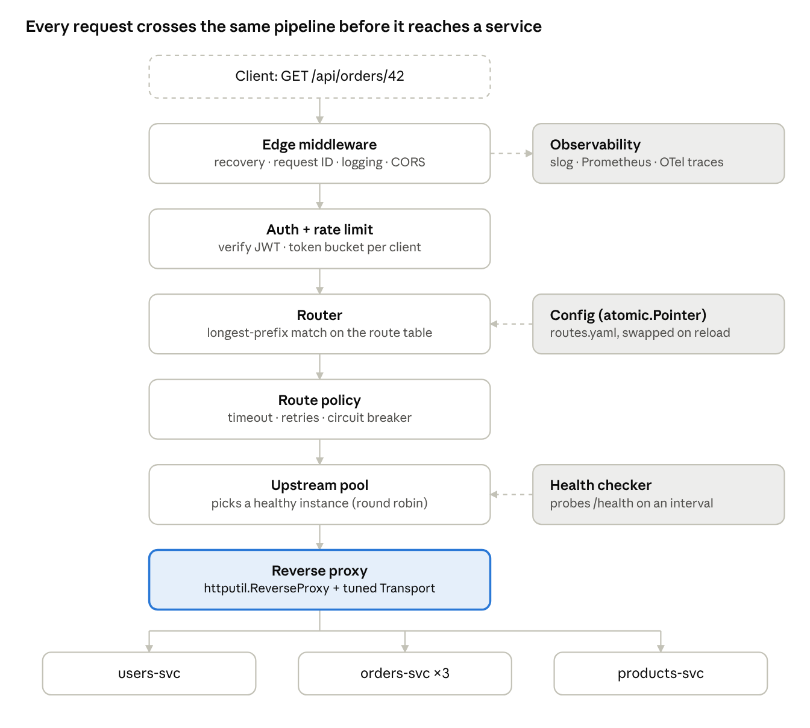

# Build Your Own API Gateway in Go

Oct 2, 2026 · @Gerardo Morales Ramos

## How to use this plan

You will build a working API Gateway in Go, stdlib-first, across 12 milestones; each one adds one gateway responsibility and one concept you must be able to explain out loud.

The rules of the game:

- **You get blueprints, not code.** Each milestone gives a goal, the concepts to study, build tasks, Go *signatures* and stdlib pointers, and self-check questions. The bodies are yours to write.
- **Stdlib first.** `net/http`, `net/http/httputil`, `context`, `sync`, `sync/atomic`, `log/slog`. Small libraries are allowed only where noted (JWT parsing, Redis client, Prometheus/OTel).
- **Break it on purpose.** Every milestone has a "break it" experiment. Seeing a failure mode beats reading about it.
- **Explain before you move on.** If you can't answer the self-check questions in two or three sentences without notes, you're not done.
- **No dates.** Milestones are sequential; spend as long as each one needs.

A milestone is **done** when: the feature works against the toy backends, it has at least one table-driven test (use `httptest.NewServer` as a fake upstream), you ran the break-it experiment, and you wrote a short `NOTES.md` entry in your own words.

When you finish a milestone, bring your code back to chat and ask for a review. I'll review it like a senior engineer would: idioms, races, edge cases, and what would break in production.

## The pattern in one page

An API Gateway is a single entry point that sits between clients and your services: it routes each request to the right backend and handles the cross-cutting concerns (auth, rate limits, timeouts, observability) so services don't each reimplement them.

**Analogy: a hotel front desk.** Guests (clients) never wander the back corridors looking for housekeeping, the kitchen or maintenance (services). They go to one desk. The desk checks your room key (authentication), decides who handles your request (routing), refuses the guest who calls 40 times a minute (rate limiting), and if the kitchen doesn't answer in a reasonable time, tells you so instead of leaving you on hold forever (timeouts, circuit breaking). The desk does *not* cook: business logic stays in the services.

```text
                 ┌──────────────────────────── API GATEWAY ─────────────────────────────┐
  Web / Mobile   │                                                                      │
  ─────────────► │  TLS ─► RequestID ─► Logging ─► Auth ─► RateLimit ─► Router ─► Proxy  │
  one host,      │                                                    │          │       │
  one API        └────────────────────────────────────────────────────┼──────────┼───────┘
                                                                      │          │
                                    ┌──────────────┬──────────────────┘          │ LB + health
                                    ▼              ▼                             ▼
                              users-svc      orders-svc ×3                products-svc
                              :9001          :9002 :9012 :9022             :9003
```

The three classic responsibilities (Microsoft's names for them are a useful mental index):

1. **Gateway Routing** — map one public URL space onto many internal services (`/api/users/*` → users-svc).
2. **Gateway Offloading** — move shared concerns to the edge: TLS termination, authN, rate limiting, CORS, compression, logging.
3. **Gateway Aggregation** — fan one client request out to several services and compose a single response, saving the client round-trips.

When **not** to use it (you should be able to argue this in an interview):

- It's a new hop: extra latency (usually sub-millisecond to a few ms) and a component that must be highly available, or it's a single point of failure.
- It can become a "god gateway" if business logic creeps in. Rule of thumb: the gateway knows *about* requests, not *about* the domain.
- With one service and one client, a plain reverse proxy (or the cloud load balancer) is enough.

Related patterns you'll meet along the way:

| Pattern | How it relates to an API Gateway |
| --- | --- |
| Reverse proxy | The gateway's core mechanism; a gateway is a reverse proxy plus policy |
| Backend for Frontend (BFF) | One gateway per client type (web, mobile), each shaped for that client |
| Service mesh / sidecar | Handles service-to-service (east–west) traffic; the gateway handles client-to-service (north–south) |
| Load balancer | L4/L7 traffic spreading; a gateway usually embeds an L7 balancer per upstream |
| Managed gateways | AWS API Gateway, Kong, Envoy, Traefik, KrakenD: what you'd use in production, and what you're rebuilding to understand |

## Target architecture and repo layout

By the end you'll have one Go binary that runs every request through a fixed pipeline of middleware, then a router, then per-route policy, then a load-balanced reverse proxy.

&#91;embedded content: gateway request pipeline · 6 stages, 3 side components\]

Read it top to bottom: each box is one `func(http.Handler) http.Handler` or one small package. The highlighted box is where you start (M1); everything above it is added milestone by milestone.

**Suggested repo layout** (one Go module, multiple binaries):

```text
api-gateway/
├── cmd/
│   ├── gateway/main.go        # wiring only: load config, build chain, start server
│   └── toysvc/main.go         # ONE toy backend binary, configured by flags/env
├── internal/
│   ├── config/                # parse + validate routes.yaml → []Route
│   ├── router/                # match request → Route
│   ├── proxy/                 # ReverseProxy construction, Transport tuning
│   ├── middleware/            # requestid, logging, recovery, auth, ratelimit, cors
│   ├── upstream/              # pool, balancer, health checker
│   ├── resilience/            # retry, circuitbreaker, bulkhead
│   ├── aggregate/             # fan-out composition endpoints
│   └── telemetry/             # metrics + tracing setup
├── configs/routes.yaml
├── deploy/docker-compose.yaml
└── NOTES.md                   # your learning journal
```

**The toy backends.** Write *one* small `toysvc` binary and run it several times with different flags (`-name orders -port 9002`). Give it a few knobs, because they let you trigger every failure mode on demand:

- `GET /health` — returns 200, or 503 when `-unhealthy` is set.
- `GET /*` — echoes back its own name, instance port, the request path, and **all received headers** as JSON (so you can see exactly what the gateway forwarded).
- `-latency 300ms` — sleeps before responding.
- `-fail-rate 0.3` — returns 500 on 30% of requests.

**Core types to design yourself** (shape only; fields and method bodies are your call):

```go
type Middleware func(http.Handler) http.Handler

func Chain(h http.Handler, mws ...Middleware) http.Handler // order matters: think about why

type Route struct {
    // name, path prefix, allowed methods, strip-prefix flag,
    // upstream pool, timeout, retry policy, auth required, rate-limit policy
}

type Balancer interface {
    Next() (*Upstream, error) // must be safe for concurrent use
}
```

## Milestones

Twelve milestones in four phases: **Foundations** (M0–M3), **Edge policy** (M4–M6), **Reliability** (M7–M9), **Operability** (M10–M11). Each builds on the previous one, so do them in order.

### M0 — Toy backends and a lab

**Goal:** a reproducible playground where you can make a backend slow, flaky or dead with one flag.

**Study:** what a reverse proxy is vs. a forward proxy; how `docker compose` networking resolves service names via DNS.

**Build:**

- [ ] `cmd/toysvc` with the knobs from the architecture section (`-name`, `-port`, `-latency`, `-fail-rate`, `-unhealthy`).
- [ ] Run users, orders (×3 on different ports) and products, first with `go run`, then with `docker compose`.
- [ ] A `Makefile` or `justfile` with `make lab-up`, `make lab-down`.

**Go hints:** `flag` package, `time.Sleep` for latency, `math/rand/v2` for fail rate, `json.NewEncoder(w).Encode(...)` to echo `r.Header`.

**Self-check:** Why is one configurable binary better than three hand-written services for this lab?

### M1 — A single-route reverse proxy

**Goal:** `GET localhost:8080/anything` reaches users-svc, and you can explain every header that changed on the way.

**Study:**

- `httputil.ReverseProxy`, specifically the **`Rewrite`** hook (Go 1.20+) and why it replaced `Director`.
- **Hop-by-hop headers** (`Connection`, `Keep-Alive`, `Transfer-Encoding`, `Upgrade`, …) vs end-to-end headers (RFC 9110 §7.6.1).
- `X-Forwarded-For`, `X-Forwarded-Host`, `X-Forwarded-Proto`, and the standardized `Forwarded` header (RFC 7239).
- The `Host` header: should the upstream see the client's host or its own?

**Build:**

- [ ] A gateway binary on `:8080` that proxies everything to one upstream URL from a flag.
- [ ] Set `X-Forwarded-*` correctly using `ProxyRequest.SetXForwarded()`.
- [ ] A custom `ErrorHandler` that returns `502 Bad Gateway` as JSON instead of the default plain text.

**Go hints:**

```go
rp := &httputil.ReverseProxy{
    Rewrite: func(pr *httputil.ProxyRequest) { /* SetURL, SetXForwarded, ... */ },
    ErrorHandler: func(w http.ResponseWriter, r *http.Request, err error) { /* ... */ },
}
```

**Break it:** kill users-svc and curl the gateway. What status do you get, and how long did it take? (You'll fix the "how long" in M4.)

**Self-check:** What would go wrong if a proxy forwarded `Connection: close` or `Upgrade` blindly? Why must a gateway *append* to `X-Forwarded-For` rather than trust what the client sent?

### M2 — Config-driven routing

**Goal:** one gateway, many services, routes defined in `configs/routes.yaml`, not in code.

**Study:** path-prefix vs exact vs pattern routing; longest-prefix-match (the same rule IP routing tables use); Go 1.22's enhanced `ServeMux` patterns (`GET /api/users/{id}`) and their precedence rules.

**Build:**

- [ ] A `config` package that parses YAML into `[]Route` and **validates** it (duplicate prefixes, bad URLs, unknown upstreams) at startup. Fail fast.
- [ ] A `router` that maps `/api/users/*` → users-svc, `/api/orders/*` → orders-svc, with optional **strip-prefix** (`/api/users/42` → `/42`).
- [ ] Method allow-lists per route; return `405` with an `Allow` header when the method doesn't match.
- [ ] One `ReverseProxy` per upstream, built once at startup (not per request).

**Go hints:** `strings.HasPrefix`, `strings.TrimPrefix`, `url.JoinPath`. YAML parsing is the one place you may pull in `gopkg.in/yaml.v3` (or use JSON and stay pure stdlib).

**Break it:** add routes `/api/user` and `/api/users`. Does `/api/users/1` go where you expect? What about `/api/username`?

**Self-check:** Why should a request for `/api/username` *not* match the prefix `/api/user`? How did you enforce segment boundaries?

### M3 — Middleware chain

**Goal:** cross-cutting behavior composed as `func(http.Handler) http.Handler`, with a request ID that follows the request all the way to the upstream and back.

**Study:** the decorator pattern; why middleware order matters (onion model: first added = outermost); `context.WithValue` with an **unexported key type**; wrapping `http.ResponseWriter` to capture the status code, and why naive wrappers break `http.Flusher` / `http.Hijacker` (see `http.ResponseController` and the `Unwrap()` convention).

**Build:**

- [ ] `Recovery`: turns a panic into a 500 and logs the stack. Must be outermost. Why?
- [ ] `RequestID`: reuse incoming `X-Request-ID` if valid, else generate one; set it on the upstream request and on the response.
- [ ] `AccessLog` with `log/slog`: method, route name, status, bytes, duration, request ID.
- [ ] `Chain(h, mws...)` helper, plus a test proving the execution order.

**Go hints:**

```go
type ctxKey int
const requestIDKey ctxKey = iota

type statusRecorder struct {
    http.ResponseWriter
    status int
    bytes  int
}
func (r *statusRecorder) Unwrap() http.ResponseWriter // lets ResponseController reach Flush/Hijack
```

**Break it:** put `Recovery` innermost and trigger a panic inside `AccessLog`. What happens to the connection?

**Self-check:** Why is a custom key type safer than a `string` key in `context.WithValue`? What happens to streaming responses (SSE) if your recorder hides `Flush()`?

### M4 — Timeouts, context and the Transport

**Goal:** no request can hang forever, a client that hangs up cancels the upstream call, and connections to upstreams are reused.

**Study:**

- The four `http.Server` timeouts (`ReadHeaderTimeout`, `ReadTimeout`, `WriteTimeout`, `IdleTimeout`) and the **Slowloris** attack.
- Per-request deadlines with `context.WithTimeout`, and how `ReverseProxy` propagates `r.Context()` cancellation to the upstream.
- `http.Transport` connection pooling: `MaxIdleConns`, `MaxIdleConnsPerHost` (default is only 2!), `IdleConnTimeout`, `DialContext` timeout, `ResponseHeaderTimeout`.
- `504 Gateway Timeout` vs `502 Bad Gateway`: who failed, and how?

**Build:**

- [ ] Server timeouts set explicitly on your `http.Server` (never use `http.ListenAndServe` with zero-value timeouts in a gateway).
- [ ] A per-route `timeout` from config, enforced by a middleware that wraps `r.Context()`.
- [ ] One shared, tuned `*http.Transport` for all proxies.
- [ ] `ErrorHandler` maps `context.DeadlineExceeded` → 504, `context.Canceled` → 499-style log (client went away), others → 502.

**Go hints:** `errors.Is(err, context.DeadlineExceeded)`; `httptrace.ClientTrace` (`GotConn`, `WasReused`) to *prove* connections are reused.

**Break it:** run orders-svc with `-latency 5s` and a route timeout of 1s. Then use `hey` or `vegeta` with `MaxIdleConnsPerHost: 2` vs `100` and watch `ss -tan | grep TIME_WAIT` explode with the default.

**Self-check:** Why is an unbounded upstream call dangerous for the *gateway's* health, not just the request? Draw what happens to goroutines and file descriptors.

### M5 — Authentication at the edge

**Goal:** the gateway verifies identity once; services trust a header the gateway sets, and nobody outside can forge it.

**Study:**

- JWT structure (header.payload.signature, RFC 7519); claims `exp`, `nbf`, `iss`, `aud`.
- Symmetric (HS256) vs asymmetric (RS256/ES256) signing, and **JWKS** for key rotation.
- The "confused deputy" / header-spoofing risk: a client sending `X-User-ID: admin` directly.
- Edge auth vs zero-trust: should services *also* verify the token? (Know both arguments.)

**Build:**

- [ ] `Auth` middleware enabled per route (`auth: required | optional | none`).
- [ ] Start with HS256 and a shared secret; then switch to RS256 and load the public key from a JWKS endpoint served by a toy auth service, with caching and refresh.
- [ ] **Strip** any incoming `X-User-*` headers before setting your own from verified claims.
- [ ] `401` with `WWW-Authenticate: Bearer` on missing/invalid token.

**Go hints:** allowed library: `github.com/golang-jwt/jwt/v5`. Always pin the expected algorithm in the key func (look up the classic `alg: none` and algorithm-confusion attacks). Cache JWKS keys in a `sync.RWMutex`-guarded map keyed by `kid`.

**Break it:** send a token signed with the wrong key, an expired token, and a request with a hand-written `X-User-ID` header. All three must be rejected or neutralized.

**Self-check:** Why is stripping inbound identity headers as important as validating the JWT?

### M6 — Rate limiting

**Goal:** protect upstreams from abusive clients with a per-client limit, first in memory, then shared across gateway replicas.

**Study:**

- Algorithms: fixed window, sliding log, sliding window counter, **token bucket**, leaky bucket. Know the burst behavior of each.
- `429 Too Many Requests` (RFC 6585) and the `Retry-After` header; the IETF `RateLimit-*` header draft.
- Why an in-memory limiter is wrong once you run N gateway replicas behind a load balancer.

**Build:**

- [ ] Your own token bucket: `Allow() bool` using `time.Now()` math (refill lazily on each call, no ticker goroutine per client).
- [ ] A per-key limiter map (key = user ID from M5, else client IP) with **eviction** of idle keys so memory doesn't grow forever.
- [ ] Compare against `golang.org/x/time/rate` and write down the differences.
- [ ] Distributed version backed by Redis (allowed library: `github.com/redis/go-redis/v9`) using a Lua script so check-and-decrement is atomic.

**Go hints:**

```go
type TokenBucket struct {
    mu       sync.Mutex
    tokens   float64
    capacity float64
    rate     float64   // tokens per second
    last     time.Time
}
func (b *TokenBucket) Allow() bool
```

**Break it:** run `go test -race` with 100 goroutines hammering one bucket. Then run two gateway instances and show the in-memory limit lets through 2× the traffic.

**Self-check:** How do you pick the client key behind a proxy or CDN without letting clients spoof `X-Forwarded-For` to dodge the limit? What should happen when Redis is down: fail open or fail closed?

### M7 — Load balancing and health checks

**Goal:** orders-svc runs 3 instances; the gateway spreads load across them and stops sending traffic to a dead one within seconds.

**Study:**

- Balancing strategies: round robin, weighted round robin, random, **least connections**, power-of-two-choices (P2C), consistent hashing (for sticky sessions/caches).
- **Active** health checks (the gateway probes `/health`) vs **passive** (outlier detection: eject an instance after N consecutive failures). Envoy's docs explain both well.
- Service discovery: static list → DNS (`net.LookupHost`, SRV records) → registry (Consul) → Kubernetes endpoints.

**Build:**

- [ ] `upstream.Pool` holding instances with an `atomic.Bool` healthy flag and an `atomic.Int64` in-flight counter.
- [ ] Round robin with an `atomic.Uint64` counter that **skips unhealthy** instances; then least-connections; make it selectable per route.
- [ ] A health-checker goroutine per pool: `time.Ticker`, a short-timeout client, thresholds (`unhealthy_after: 3`, `healthy_after: 2`) to avoid flapping.
- [ ] Passive ejection: mark an instance unhealthy after consecutive 5xx/connection errors seen in `ErrorHandler`.
- [ ] Clean shutdown of checker goroutines via `context`.

**Go hints:** you can no longer build one `ReverseProxy` per route with a fixed target. In `Rewrite`, pick the instance (`pr.SetURL(pool.Next().URL)`) — or keep one proxy per instance. Think about which is simpler to observe.

**Break it:** start the lab, then `docker stop` one orders instance mid-load-test. Count failed requests before it's ejected. Restart it and confirm it rejoins.

**Self-check:** Why is round robin poor when instances have very different latency? When would you need consistent hashing?

### M8 — Resilience: retries, circuit breaker, bulkhead

**Goal:** transient failures are absorbed, persistent ones fail fast, and one slow service can't starve the others.

**Study:**

- **Idempotency**: which HTTP methods are safe to retry (RFC 9110 §9.2.2), and why a POST retry can double-charge someone. Idempotency keys.
- Exponential backoff **with jitter** (full vs equal vs decorrelated) and **retry budgets** to avoid retry storms.
- Circuit breaker state machine: **Closed → Open → Half-Open**; failure-rate vs consecutive-failure thresholds.
- Bulkhead: bound concurrent in-flight requests per upstream so one slow service doesn't consume every goroutine and connection.
- Request bodies are streams: once read, they're gone. `http.Request.GetBody` exists for replay.

**Build:**

- [ ] Retry middleware/transport: only for idempotent methods (or with an `Idempotency-Key`), max attempts from config, backoff + jitter, honors the request's context deadline (never retry past it).
- [ ] Your own `CircuitBreaker` per upstream (not a library — this is the point): `Allow() error`, `Record(success bool)`, a half-open probe limit, state transitions logged.
- [ ] Bulkhead: a buffered channel as a semaphore per upstream; when full, return `503` immediately instead of queuing.
- [ ] Decide where each lives: as an `http.RoundTripper` wrapper around the Transport, or as middleware? Write down why.

**Go hints:**

```go
type RoundTripperFunc func(*http.Request) (*http.Response, error)

type State int // Closed, Open, HalfOpen
type CircuitBreaker struct { /* mu, state, counters, openedAt, config */ }
func (cb *CircuitBreaker) Allow() error
func (cb *CircuitBreaker) Record(err error)
```

**Break it:** run orders with `-fail-rate 0.5`. Compare error rate seen by clients with retries off vs on. Then `-fail-rate 1.0`: confirm the breaker opens and requests fail in microseconds, not after the timeout.

**Self-check:** Retries + circuit breaker + timeouts interact: in what order do they wrap each other, and what happens if retries sit *outside* the breaker vs *inside*? How do retries at the gateway multiply with retries inside services?

### M9 — Aggregation (API composition)

**Goal:** `GET /api/order-summary/{id}` calls orders, users and products concurrently and returns one JSON document.

**Study:** the Gateway Aggregation and **Backend for Frontend** patterns; fan-out/fan-in with `errgroup`; partial failure strategies (fail whole vs degrade with `null` fields); latency = slowest call, not the sum.

**Build:**

- [ ] An `aggregate` handler registered as a special route type in config.
- [ ] Fetch the order first (it holds `user_id` and `product_ids`), then users and products **in parallel**.
- [ ] Propagate the request ID, auth identity and the deadline to every sub-call.
- [ ] Degrade gracefully: if products times out, return the order with `"products": null` and a `warnings` array.

**Go hints:** `golang.org/x/sync/errgroup` with `errgroup.WithContext` (or build your own with `sync.WaitGroup` + an error channel first, then compare). Reuse the same Transport and resilience wrappers from M8.

**Break it:** give users-svc `-latency 2s`. Is your aggregate endpoint 2s slow or does it degrade? Then cancel the client request mid-flight: are all sub-requests cancelled?

**Self-check:** Where is the line between aggregation and business logic? What would make you move this endpoint into its own BFF service?

### M10 — Observability

**Goal:** for any request you can answer: which route, which instance, how long each hop took, and why it failed.

**Study:**

- The **RED** method (Rate, Errors, Duration) per route and per upstream; why latency belongs in a **histogram**, not an average.
- Metric **cardinality**: why labeling by raw path (`/api/users/42`) will melt Prometheus, and why you label by route name instead.
- Distributed tracing: spans, trace context propagation via W3C `traceparent`; the gateway is usually the **root span**.
- Correlating logs ↔ traces by putting `trace_id` in every `slog` line.

**Build:**

- [ ] `/metrics` endpoint (allowed: `github.com/prometheus/client_golang`): `gateway_requests_total{route,code}`, `gateway_request_duration_seconds{route}` histogram, `gateway_upstream_healthy{upstream,instance}` gauge, breaker state gauge.
- [ ] OpenTelemetry tracing (allowed: `go.opentelemetry.io/otel`): server span per request, client span per upstream attempt (so retries show up as separate spans), exported to Jaeger in your compose lab.
- [ ] Instrument `toysvc` too, so you see the full trace across the hop.
- [ ] A Grafana dashboard with the four golden signals.

**Go hints:** `otelhttp.NewHandler` and `otelhttp.NewTransport` exist, but write one span manually first to understand what they do. Serve `/metrics` on a separate admin port, not the public one.

**Break it:** turn on `-fail-rate 0.3` + `-latency 200ms` on one orders instance. Find that instance using only your dashboard and a trace, without reading logs.

**Self-check:** Why should `/metrics` and `/debug/pprof` never be exposed on the public listener?

### M11 — Production readiness

**Goal:** the gateway can be deployed, reconfigured and restarted without dropping requests, and you know its throughput limits.

**Study:** graceful shutdown and connection draining; readiness vs liveness probes; hot config reload with an atomic pointer swap (copy-on-write, no locks on the hot path); TLS termination; profiling with `pprof`.

**Build:**

- [ ] Graceful shutdown: `signal.NotifyContext` for SIGINT/SIGTERM → flip readiness to failing → `server.Shutdown(ctx)` with a deadline → stop health checkers.
- [ ] Hot reload on SIGHUP (or file watch): parse + validate new config, build a new route table, swap via `atomic.Pointer[RouteTable]`. Invalid config = keep the old one and log.
- [ ] `/healthz` (liveness) and `/readyz` (readiness) on the admin port.
- [ ] TLS with `ListenAndServeTLS` and a local cert (`mkcert`); know where TLS usually terminates in AWS (ALB/NLB) instead.
- [ ] Multi-stage `Dockerfile` → distroless or scratch image, non-root user.
- [ ] Load test with `k6` or `vegeta`; capture a CPU and heap profile under load and find your top hot spot.

**Go hints:** `atomic.Pointer[T]` (Go 1.19+), `net/http/pprof` on the admin mux only, `go test -bench . -benchmem` for the router match function.

**Break it:** reload config in a loop while running a load test: zero 5xx allowed. Send SIGTERM during a load test: zero dropped in-flight requests allowed.

**Self-check:** Why is `atomic.Pointer` better than an `RWMutex` for a read-mostly route table? What's the trade-off?

## Stretch goals

Pick any of these once M11 is done; each one deepens a different specialization.

| Stretch | What you'd learn | Where it connects |
| --- | --- | --- |
| Response caching with `singleflight` | `Cache-Control` semantics, cache stampede / thundering herd, request coalescing | M4, M9 |
| WebSocket and SSE proxying | Connection upgrade, hijacking, long-lived connections vs timeouts | M1, M3, M4 |
| Canary and weighted routing | Route 5% of traffic by weight or header to a new version; progressive delivery | M2, M7 |
| gRPC upstreams | HTTP/2, h2c, trailers; JSON↔gRPC transcoding (study how grpc-gateway does it) | M1, M4 |
| Plugin system | Go interfaces as extension points; compare with Traefik's Yaegi-interpreted plugins and Envoy's WASM filters | M3 |
| Kubernetes deploy | Deployment + Service + HPA, readiness gates, discovering upstreams from EndpointSlices | M7, M11 |
| AWS deploy | ECS Fargate behind an ALB; then compare your gateway with **AWS API Gateway** on cost, latency, and what you'd give up | M11 |
| mTLS to upstreams | Zero-trust between gateway and services; what a service mesh automates for you | M5 |

## Reading list

Read the pattern sources before M1, then the rest just-in-time as each milestone needs them.

| Resource | Read it for | Milestone |
| --- | --- | --- |
| [microservices.io: API Gateway / BFF](https://microservices.io/patterns/apigateway.html) | The canonical pattern write-up, forces and trade-offs | Before M0 |
| [Azure: Gateway Routing](https://learn.microsoft.com/en-us/azure/architecture/patterns/gateway-routing), [Offloading](https://learn.microsoft.com/en-us/azure/architecture/patterns/gateway-offloading), [Aggregation](https://learn.microsoft.com/en-us/azure/architecture/patterns/gateway-aggregation) | Vendor-neutral breakdown of the three responsibilities | Before M0 |
| Sam Newman, *Building Microservices* (2nd ed.), chapters on communication and edge | Where gateways fit and where they go wrong | Before M0 |
| [`net/http/httputil` docs](https://pkg.go.dev/net/http/httputil) | `ReverseProxy`, `ProxyRequest`, `Rewrite` | M1 |
| [RFC 9110 (HTTP Semantics)](https://www.rfc-editor.org/rfc/rfc9110) | Hop-by-hop headers, idempotent methods, 502/503/504 | M1, M8 |
| [Cloudflare: Go net/http timeouts](https://blog.cloudflare.com/the-complete-guide-to-golang-net-http-timeouts/) | The clearest explanation of server and client timeouts | M4 |
| [`golang.org/x/time/rate`](https://pkg.go.dev/golang.org/x/time/rate) | Reference token bucket to compare with yours | M6 |
| [Envoy: load balancing and outlier detection](https://www.envoyproxy.io/docs/envoy/latest/intro/arch_overview/upstream/load_balancing/overview) | How a production proxy does M7 | M7 |
| [AWS: Exponential Backoff and Jitter](https://aws.amazon.com/blogs/architecture/exponential-backoff-and-jitter/) | Why jitter matters, with simulations | M8 |
| [Martin Fowler: Circuit Breaker](https://martinfowler.com/bliki/CircuitBreaker.html) + Michael Nygard, *Release It!* | The state machine and the stability patterns around it | M8 |
| [Google SRE book: Handling Overload](https://sre.google/sre-book/handling-overload/) | Retry budgets, load shedding, client-side throttling | M6, M8 |
| [OpenTelemetry Go docs](https://opentelemetry.io/docs/languages/go/) | Spans, propagation, exporters | M10 |
| [Traefik](https://github.com/traefik/traefik) and [KrakenD](https://github.com/krakend/krakend-ce) source | Two real gateways written in Go: read their middleware and proxy packages *after* you've built yours | After M11 |

Tools for the lab: `curl -v`, [`hey`](https://github.com/rakyll/hey) or [`vegeta`](https://github.com/tsenart/vegeta) for load, Jaeger + Prometheus + Grafana in `docker compose`, `go test -race` always on.

## Progress tracker

Update the status as you go; when a milestone hits **Built, needs review**, paste your code (or the repo link) into chat and ask for a review against that milestone's self-check questions.

| Milestone | Status | Key concept to explain out loud | Notes |
| --- | --- | --- | --- |
| M0 Toy backends and lab | In progress | Reverse vs forward proxy | Toysvc + compose done; NOTES entry pending |
| M1 Single-route reverse proxy | In progress | Hop-by-hop headers, X-Forwarded-For | Needs JSON 502 + Host decision |
| M2 Config-driven routing | Built, needs review | Longest-prefix match on segment boundaries | Tests + e2e pass; ready for review |
| M3 Middleware chain | Not started | Onion model, ResponseWriter wrapping |  |
| M4 Timeouts and Transport | Not started | Context cancellation, connection pooling |  |
| M5 Edge authentication | Not started | JWT + JWKS, header stripping |  |
| M6 Rate limiting | Not started | Token bucket, distributed limits |  |
| M7 Load balancing + health | Not started | Active vs passive health checks |  |
| M8 Retries, breaker, bulkhead | Not started | Idempotency, jitter, breaker states |  |
| M9 Aggregation | Not started | Fan-out/fan-in, partial failure |  |
| M10 Observability | Not started | RED metrics, cardinality, trace propagation |  |
| M11 Production readiness | Not started | Graceful shutdown, atomic hot reload |  |

**How to check in with me:** say which milestone you're on and either (a) the concept you're stuck on, and I'll explain it with an analogy and diagram without handing you the solution, or (b) your code, and I'll review it and ask the self-check questions back to you, interview-style.


