# M2: What I coded, explained

An explanation of the M2 code, from the core concepts down to the code, plus a
walkthrough of the YAML configuration.

**Contents**

1. [Core concepts](#1-core-concepts)
2. [The life of a request](#2-the-life-of-a-request)
3. [Code walkthrough](#3-code-walkthrough)
4. [The tests](#4-the-tests)
5. [The YAML configuration](#5-the-yaml-configuration)
6. [What to remember](#6-what-to-remember)

---

## 1. Core concepts

### What an API gateway is

You have several small backend services (users, orders, products). Clients
shouldn't need to know which service lives where. The gateway is a single front
door on port 8080. A client sends `GET /api/products/1` to the gateway, and the
gateway decides which backend should handle it, forwards the request, and passes
the response back.

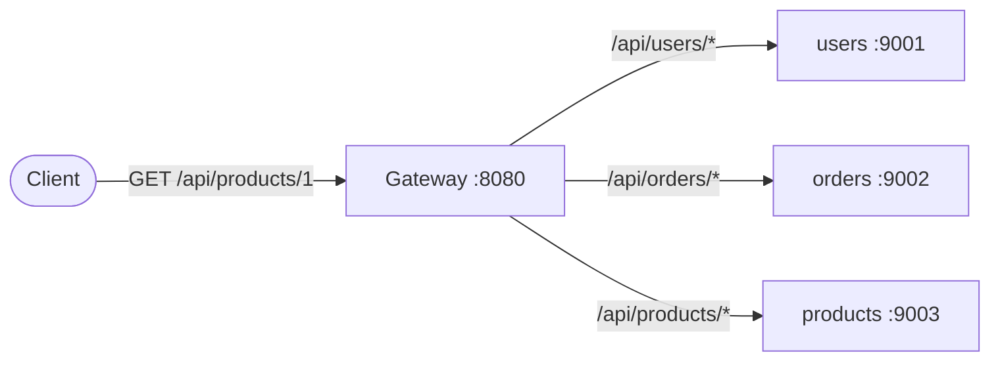

M2 is the "decide which backend" part, driven by a config file instead of being
hardcoded.

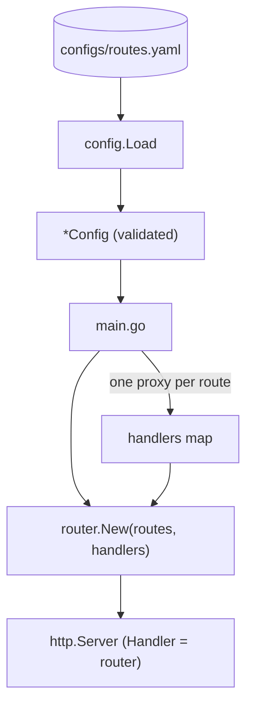

### Key terms

| Term | Meaning |
|---|---|
| **Route** | One rule: "requests whose path starts with `/api/products` go to the products upstream". It has a name, a prefix, allowed methods, and so on |
| **Upstream** | A backend service, or a group of identical instances of one |
| **Prefix match** | `/api/products/1` matches the prefix `/api/products` because it starts with it |
| **Segment boundary** | A path is made of segments split by `/`. `/api/user` should match `/api/user/7` but not `/api/username`, because `username` is a different segment |
| **Longest prefix wins** | `/api` and `/api/users` both match `/api/users/1`. The more specific one wins |
| **Strip prefix** | The gateway removes the prefix before forwarding: `/api/users/42` becomes `/42`, so the backend doesn't need to know the public URL layout |
| **Fail fast** | If the config is broken, the program refuses to start with a clear error instead of failing on user requests |
| **Defaults vs. validation** | A missing optional value gets a sensible default (`auth` becomes `none`). A value that can't be guessed (a route with no upstream) is an error |

### Segment boundary

Prefix `/api/user`:

| Path | Matches? | Why |
|---|---|---|
| `/api/user` | yes | equal to the prefix |
| `/api/user/7` | yes | starts with `/api/user` + `/` |
| `/api/username` | **no** | `name` continues the same segment |

That is why the check is:

```go
path == prefix || strings.HasPrefix(path, prefix+"/")
```

### Longest prefix wins

Routes are sorted longest first, so the first match is automatically the
longest.

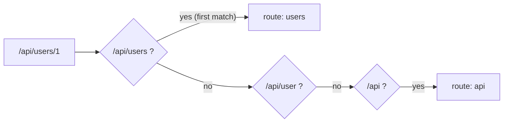

### HTTP status codes involved

| Code | When | Extra |
|---|---|---|
| **404** Not Found | No route matched | |
| **405** Method Not Allowed | The path matched but the method isn't allowed | `Allow: GET, POST` header lists the allowed ones |
| **502** Bad Gateway | The gateway couldn't reach the backend | produced by the proxy |

### Go concepts used

- **`http.Handler`** is any type with a method `ServeHTTP(w, r)`. This one
  interface is how everything in Go's web code is plugged together. Your `Router`
  is a handler. So is each proxy. The router receives a request and delegates to
  another handler.
- **Sentinel errors** (`ErrNotFound`) are fixed error values you compare with
  `errors.Is`.
- **Custom error types** (`MethodNotAllowedError`) carry extra data. You read that
  data with `errors.As` / `errors.AsType`.
- **Error wrapping:** `fmt.Errorf("...: %w", err)` adds context but keeps the
  original, so `errors.Is` still works through it.
- **Immutability:** after `New` returns, nothing changes the router. That is why
  you clone the slice and the map, so the caller can't change your table
  afterward.

---

## 2. The life of a request

`curl localhost:8080/api/products/1`

1. The server calls `rt.ServeHTTP(w, r)`.
2. The router calls `Match("GET", "/api/products/1")`.
3. `Match` scans the routes (longest prefix first) and finds `products`. It checks
   that `GET` is allowed. Since `strip_prefix` is true, it computes the upstream
   path `/1`.
4. `ServeHTTP` copies the request, sets the path to `/1` on the copy, and calls
   the `products` proxy with it.
5. The proxy forwards to `http://localhost:9003/1`, and the response goes back to
   the client.

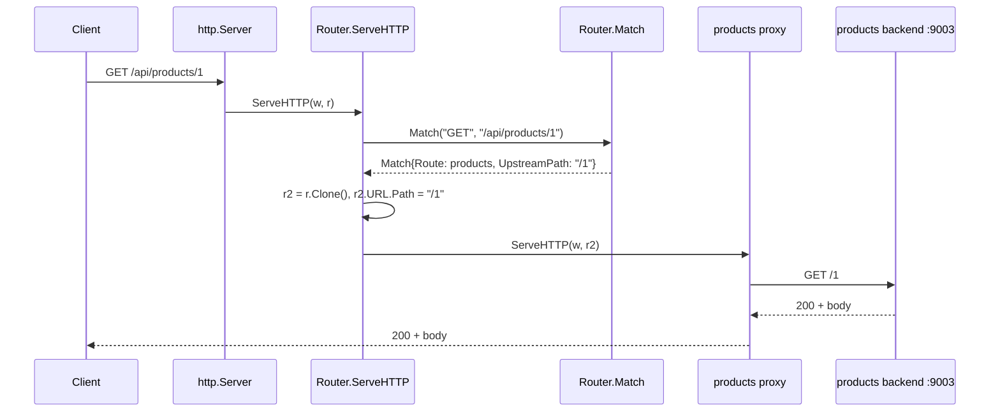

If step 3 finds no match, the client gets 404. If the method is wrong, the
client gets 405 with `Allow`.

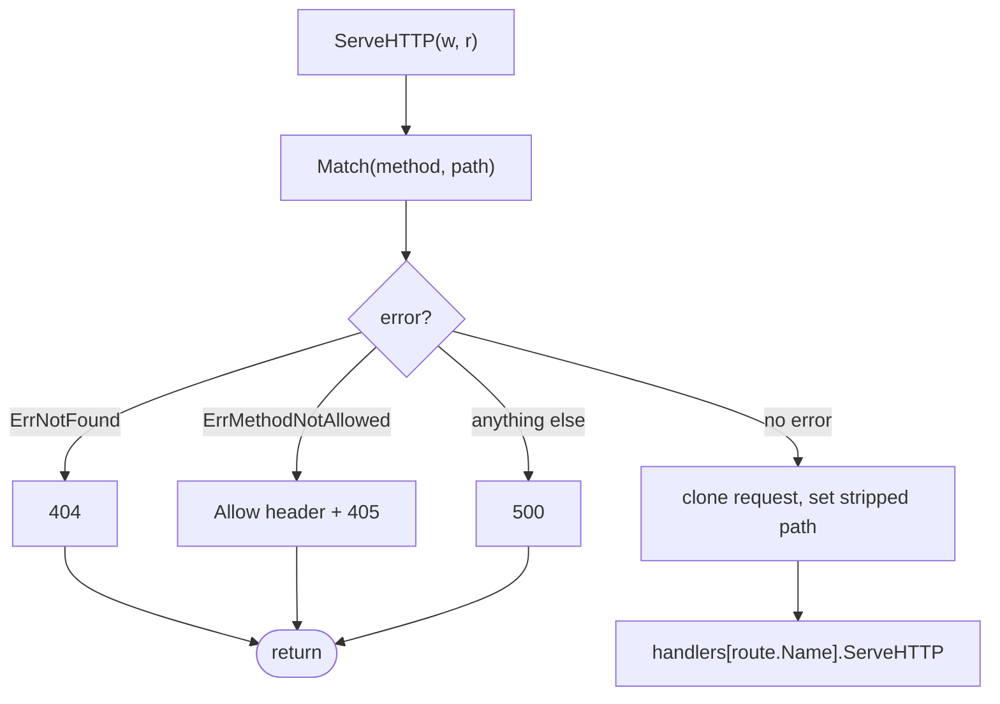

---

## 3. Code walkthrough

### `internal/config/config.go`: what the gateway should do

**The structs** (`Config`, `Server`, `Upstream`, `Route`) mirror the YAML. The
`yaml:"..."` tags tell the YAML library which key goes into which field.

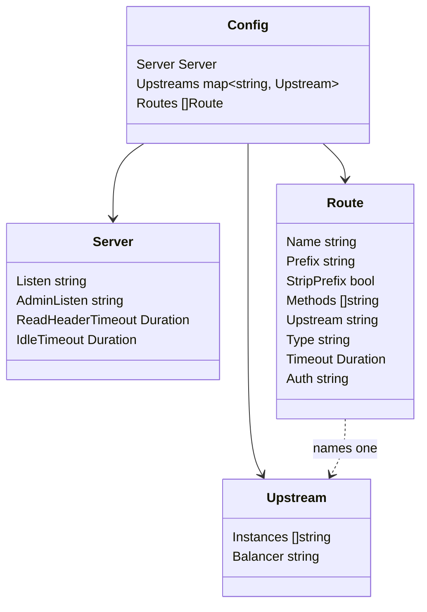

**`Load(path)`**

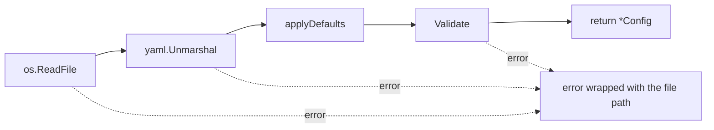

1. `os.ReadFile` reads the file.
2. `yaml.Unmarshal` fills a `Config` from it.
3. `applyDefaults` fills in missing optional values.
4. `Validate` rejects anything wrong.
5. It returns the config, or an error wrapped with the file path.

**`applyDefaults`:** `if x == "" { x = default }`. The guard matters. Without it,
you'd overwrite what the user wrote in the YAML.

**`Validate`:** it collects all the problems into a slice and returns them
together with `errors.Join`, so you see every mistake at once. The checks:

- upstreams have instances, and each URL is valid with an `http`/`https` scheme
  and a host
- routes reference existing upstreams
- prefixes are unique, start with `/`, and don't end with `/`
- route names are unique
- methods are valid and not empty
- proxy routes have an upstream, and aggregate routes have none

### `internal/router/errors.go`

- `ErrNotFound` and `ErrMethodNotAllowed` are the sentinel errors.
- `MethodNotAllowedError` carries the `Allowed` list. Its `Is` method says "I count
  as `ErrMethodNotAllowed`", so `errors.Is(err, ErrMethodNotAllowed)` is true.
  That is how one error works both ways: easy to check, and it carries data.

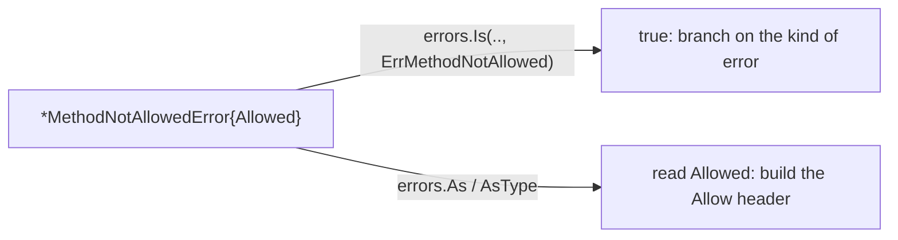

### `internal/router/router.go`

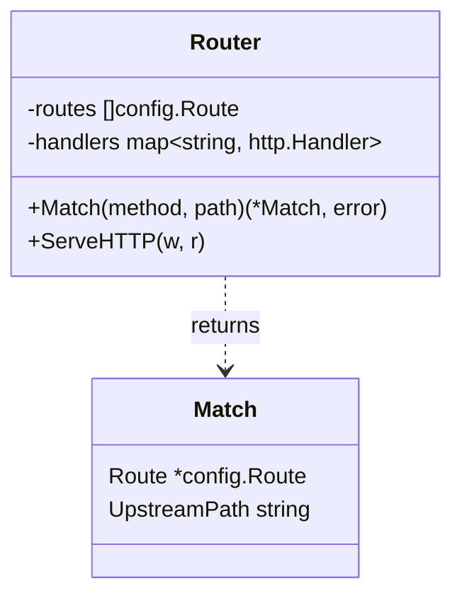

- **`Router`** holds `routes` (sorted longest-first) and `handlers` (a map from
  route name to the handler that serves it).
- **`New(routes, handlers)`** clones both inputs, sorts the routes by prefix length
  descending, and returns an error if any route has no handler.
- **`Match(method, path)`** is a pure function with no HTTP involved, so it's easy
  to test:

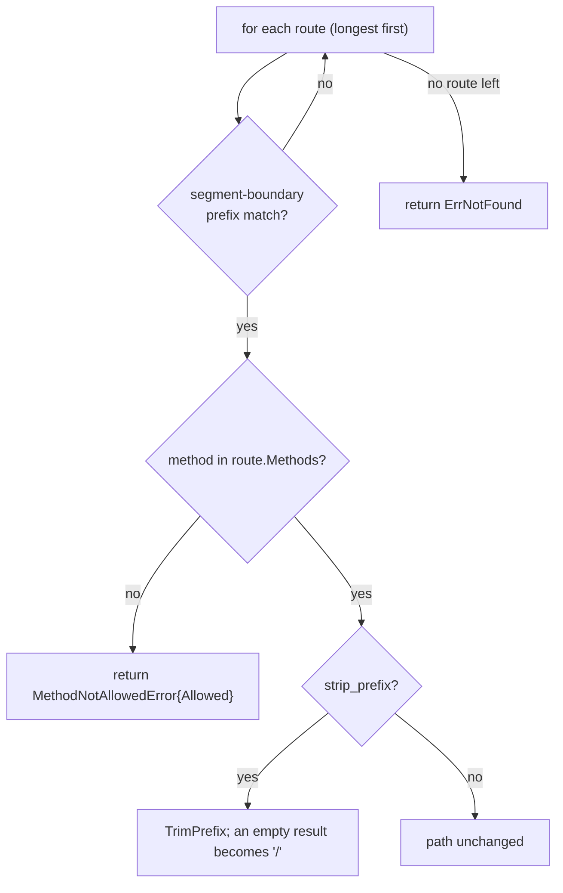

It returns `&rt.routes[i]`, a pointer into the router's own table.

- **`ServeHTTP`** is the glue. It calls `Match`, and on error it uses a `switch`
  to write exactly one error response (404, 405 plus `Allow`, or 500) and
  `return`s. On success it clones the request with `r.Clone`, sets the cloned
  URL's path to `UpstreamPath`, clears `RawPath` (otherwise the old encoded path
  could override the new one), and calls the route's handler. Cloning means the
  caller's request is never modified.

```go
r2 := r.Clone(r.Context())
r2.URL.Path = match.UpstreamPath
r2.URL.RawPath = ""
rt.handlers[match.Route.Name].ServeHTTP(w, r2)
```

### `cmd/gateway/main.go`: only wiring

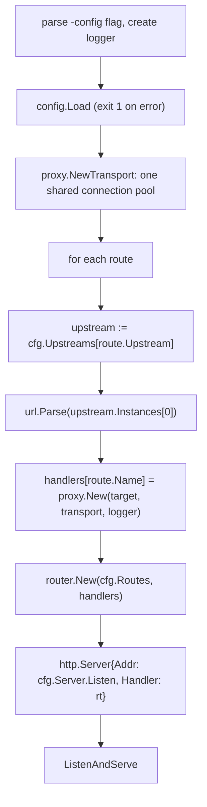

1. Parse the `-config` flag and create the logger.
2. `config.Load`. If it fails, log and `os.Exit(1)`.
3. Create one shared transport (the connection pool).
4. For each route, find its upstream, parse the first instance's URL, and build a
   proxy. Store it in `handlers[route.Name]`.
5. `router.New(cfg.Routes, handlers)`.
6. Start an `http.Server` on `cfg.Server.Listen` with the router as its handler.

Using only the first instance is a placeholder. Balancing across all instances
comes in M7.

---

## 4. The tests

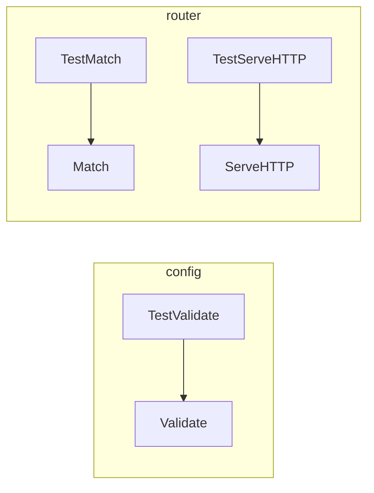

- **`TestValidate`** is table-driven: each row is a config and whether it should be
  rejected, plus a `wantMsg` that should appear in the error.
- **`TestMatch`** feeds `Match` method and path pairs and checks the route name and
  upstream path (longest prefix, segment boundary, 404, 405).
- **`TestServeHTTP`** uses `httptest.NewRecorder`, a fake `ResponseWriter` that
  records what the code wrote, so no real server is needed. It checks status
  codes, the `Allow` header, and the path the handler received. Its fake handlers
  record what they saw instead of proxying.

---

## 5. The YAML configuration

`routes.yaml` is the gateway's whole route table. `config.Load` reads it into the
`Config` struct, one key per field. The keys are the names in the `yaml:"..."`
tags.

### YAML basics

- Indentation (spaces only, never tabs) shows nesting.
- `key: value` is a field.
- `- item` is a list element. `[GET, POST]` is a list written on one line.
- `#` starts a comment.
- Values like `5s` and `50ms` are durations. The YAML library converts them into a
  Go `time.Duration`.

### The three top-level blocks

They match `Config{Server, Upstreams, Routes}`.

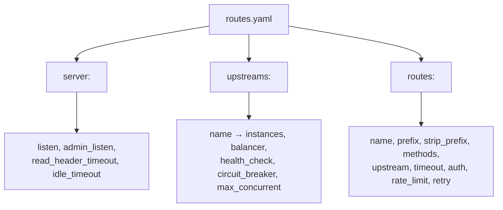

#### 1. `server:` (how the gateway itself listens)

```yaml
server:
  listen: ":8080"          # public listener
  admin_listen: ":9090"    # (M10/M11) /metrics, /healthz, /readyz, /debug/pprof; never public
  read_header_timeout: 5s  # (M4) Slowloris protection
  idle_timeout: 60s        # (M4)
```

- `listen` is the address clients connect to. `:8080` means "port 8080 on all
  interfaces". `main.go` passes it to `http.Server.Addr`.
- The other three are used in later milestones (M4, M10, M11). `Load` reads them
  now and applies defaults, but nothing uses them yet.
- If you omit any of these, `applyDefaults` fills them in (`:8080`, `:9090`, `5s`,
  `30s`). If you set one, as with `idle_timeout: 60s` here, your value wins.

#### 2. `upstreams:` (the backends)

```yaml
upstreams:
  users:
    instances:
      - http://users:9001
  orders:
    instances:
      - http://orders-1:9002
      - http://orders-2:9002
      - http://orders-3:9002
    balancer: least_conn
  products:
    instances:
      - http://localhost:9003
```

A map from a **name** (`users`, `orders`, `products`) to a group of servers.

- `instances` is the list of backend URLs. They need an `http` or `https` scheme
  and a host, which `Validate` checks. For now `main.go` only uses the first one.
  Load balancing across all of them is M7.
- Everything else (`balancer`, `health_check`, `circuit_breaker`,
  `max_concurrent`) belongs to M7 and M8. The parser accepts them and the gateway
  ignores them.
- The hostnames `users`, `orders-1`, and so on are docker compose service names.
  They only resolve inside docker, which is why `products` uses `localhost` here
  and you got a 502 earlier.

#### 3. `routes:` (the rules that decide where requests go)

```yaml
routes:
  - name: users
    prefix: /api/users
    strip_prefix: true          # /api/users/42 -> /42 at the upstream
    methods: [GET, POST]
    upstream: users
    timeout: 2s                 # (M4)
    auth: required              # (M5) required | optional | none
    rate_limit:                 # (M6)
      requests_per_second: 10
      burst: 20
```

Each list item is one `Route`:

| Key | Meaning | Used in M2? |
|---|---|---|
| `name` | Unique ID. It's the key into the handlers map, so duplicates are rejected | Yes |
| `prefix` | Public path to match, on segment boundaries. Must start with `/` and not end with `/` | Yes |
| `strip_prefix` | If true, remove the prefix before forwarding (`/api/users/42` → `/42`) | Yes |
| `methods` | Allowed HTTP methods. Others get 405 with an `Allow` header | Yes |
| `upstream` | Which entry in `upstreams:` to forward to. It must exist | Yes |
| `timeout` | Max time for the request. Default 5s | No (M4) |
| `auth` | `required`, `optional`, or `none`. Default `none` | No (M5) |
| `rate_limit` | Token bucket settings | No (M6) |
| `retry` | Retry policy | No (M8) |

The commented-out `order-summary` block in the file is an **aggregate** route
(M9). It has `type: aggregate` and no `upstream`, because it fans out to several
services. That is why `Validate` requires an upstream on normal routes and
forbids one on aggregate routes.

### How the two sections connect

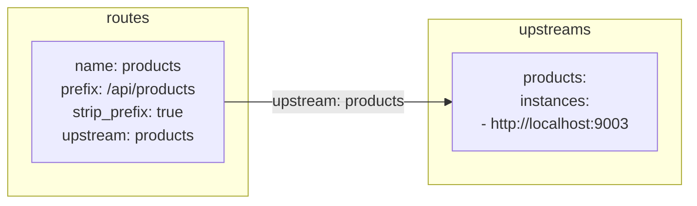

For `GET /api/products/1`:

1. The route `products` matches (prefix `/api/products`, `GET` allowed).
2. Its `upstream: products` points to `upstreams.products`.
3. That upstream's first instance is `http://localhost:9003`.
4. With `strip_prefix: true`, the request goes to `http://localhost:9003/1`.

### Order doesn't matter

The comment at the top of `routes:` says list order must not decide matching. The
router sorts by prefix length (longest first). If order mattered, putting `/api`
before `/api/users` in the file would silently swallow every `/api/users`
request. That is a bug nobody could see by reading the router code.

### What `Load` and `Validate` do with this file

1. Parse the YAML into the structs. A typo in the YAML syntax is an error here.
2. Fill in missing defaults. Auth becomes `none`, timeout becomes `5s`, and so on.
3. `Validate` checks the cross-references (the upstream exists, URLs are valid,
   prefixes are unique, and so on), and the program refuses to start on any
   problem.

One caveat: `yaml.Unmarshal` ignores keys it doesn't know. A typo like
`strip_prefx: true` is silently dropped, and the route just won't strip. Calling
`dec.KnownFields(true)` on a `yaml.NewDecoder` would reject unknown keys. It's a
good fail-fast improvement if you want one.

---

## 6. What to remember

```text
YAML ──Load──► Config ──Validate──► (fail fast)
                  │
                  ├─ Upstreams ──► one proxy per route ──┐
                  └─ Routes    ────────────────────────┐ │
                                                       ▼ ▼
                                        router.New(routes, handlers)
                                                       │
request ─► ServeHTTP ─► Match ─┬─ ErrNotFound ─────► 404
                               ├─ MethodNotAllowed ─► 405 + Allow
                               └─ ok ─► clone req, strip prefix ─► proxy ─► backend
```

1. **Config describes** the routes, and **`Validate` guards** it.
2. **`Match` decides** (pure logic), and **`ServeHTTP` acts** (HTTP glue).
3. **`main` only wires** things together.
4. Because everything is an `http.Handler`, you can plug pieces together and test
   each one alone.
