# M5: What I coded, explained

An explanation of the M5 code (authentication at the edge), from the core
concepts down to the code, plus how the toy identity provider `authsvc` fits in.

> **Status.** HS256 verification, header stripping, the three route policies,
> the tests and the real-process script are done and committed. `authsvc` is
> drafted. The RS256 path is **written and tested but not yet committed**: the
> JWKS key source (`internal/middleware/jwks.go`, `jwks_test.go`), the config
> (`jwks_url`, `jwks_refresh`), the `main.go` wiring, and
> `scripts/m5-rs256-experiments.sh`. `configs/routes.yaml` now uses RS256.

**Contents**

1. [Core concepts](#1-core-concepts)
2. [The life of a request](#2-the-life-of-a-request)
3. [Why stripping headers matters as much as verifying](#3-why-stripping-headers-matters-as-much-as-verifying)
4. [Code walkthrough](#4-code-walkthrough)
5. [HS256 vs RS256, and why authsvc exists](#5-hs256-vs-rs256-and-why-authsvc-exists)
6. [The JWKS key source](#6-the-jwks-key-source)
7. [The tests and the experiment script](#7-the-tests-and-the-experiment-script)
8. [What to remember](#8-what-to-remember)

---

## 1. Core concepts

### The problem M5 solves

Your backend services (users, orders) need to know **who is calling**. If every
service verified passwords and tokens itself, each would need the keys and the
verification code. Instead, the gateway verifies identity **once**, at the edge,
and tells the services the result in a header.

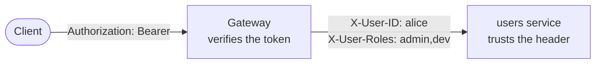

The whole design rests on one promise: **only the gateway can write
`X-User-*`**. Section 3 is about keeping that promise.

### Key terms

| Term | Meaning |
|---|---|
| **Identity provider (IdP)** | The system that logs users in and **issues** tokens (Auth0, Keycloak, Google). Never the gateway. `authsvc` is a toy one |
| **JWT** | A token of three parts: `header.payload.signature`. Anyone can read it; nobody can change it without breaking the signature |
| **Claims** | The fields in the payload: `sub` (who), `iss` (who issued it), `aud` (who it is for), `exp` (when it expires), plus custom ones like `roles` |
| **Signature** | Proof the IdP produced the token. The gateway checks it before believing any claim |
| **`alg`** | The signing algorithm, named in the token's header. It is **attacker-controlled**, so the gateway must not trust it (see below) |
| **HS256** | Symmetric: one shared secret both signs and verifies |
| **RS256** | Asymmetric: a private key signs, a public key verifies |
| **JWKS** | A JSON document at a URL listing the IdP's public keys |
| **`kid`** | "Key ID". The token says which key signed it, so the gateway can pick the right one from the JWKS |
| **Key rotation** | Replacing the signing key regularly (or after a leak) without downtime |
| **Policy** | Per route: `required` (valid token or 401), `optional` (anonymous allowed, but a bad token is 401), `none` (no checks) |

### What the gateway checks on every token

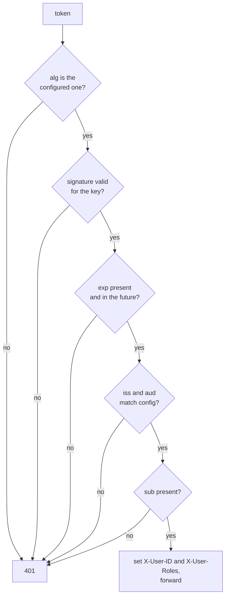

Each box is a real attack if you skip it:

| Skipped check | What an attacker does |
|---|---|
| Pinned `alg` | Sends `alg: none` (no signature at all), or flips RS256 to HS256 so the public key is used as an HMAC secret |
| Signature | Edits `sub` to `admin` |
| `exp` present | A leaked token with no `exp` lives forever |
| `iss` / `aud` | Replays a token issued for a different system |

---

## 2. The life of a request

### With a valid token (policy `required`)

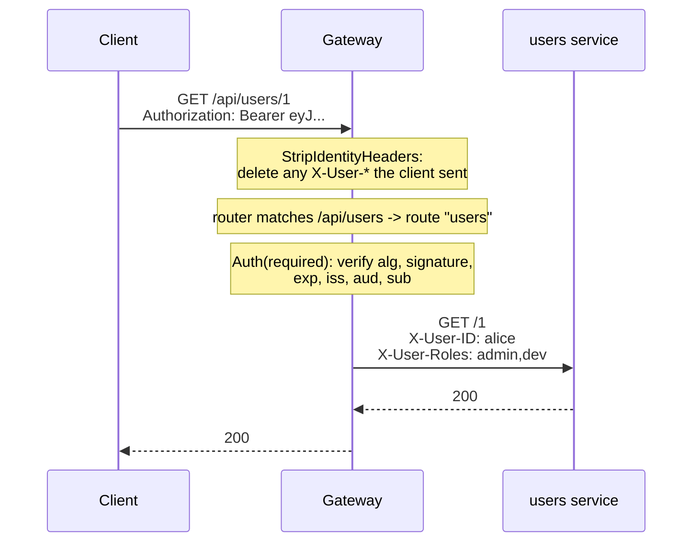

### With no token, or a bad one

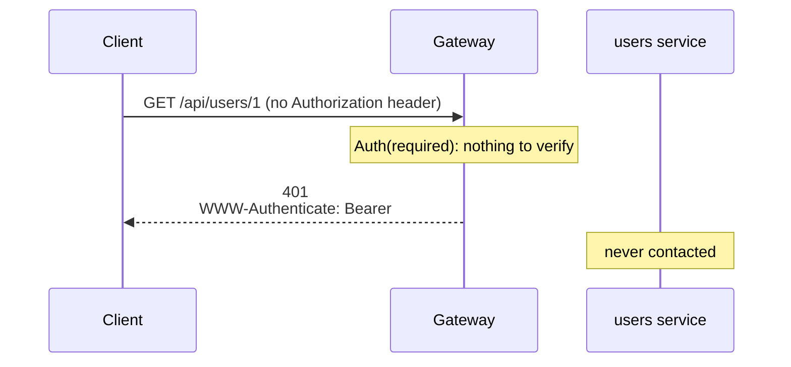

A bad token gets `WWW-Authenticate: Bearer error="invalid_token", ...`. The
description text is fixed in the code, never copied from the client, so the
header can't be injected into.

### The three policies

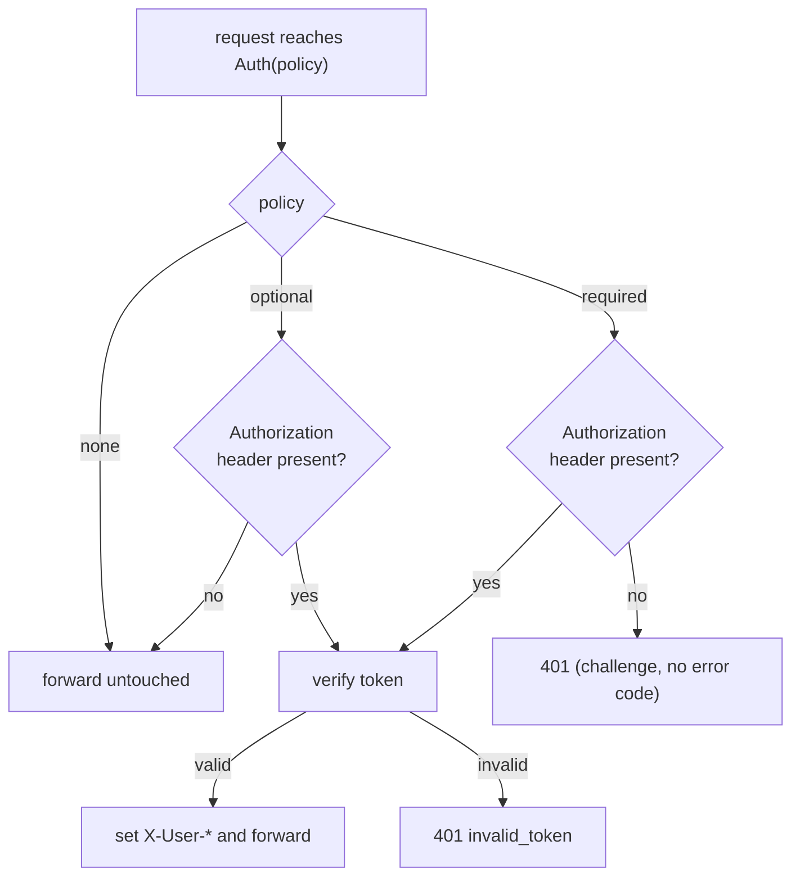

The design decision worth remembering: under `optional`, a present-but-invalid
token is **401, not anonymous**. A bad token is almost always a client bug
(expired, wrong key). Quietly downgrading to anonymous would show the user as
"logged out" with no error to debug.

---

## 3. Why stripping headers matters as much as verifying

HTTP headers are plain text. Anyone can send `X-User-ID: admin`.

**Without stripping**, on a route with `auth: none` (or `optional` with no
token), no verification runs, so the forged header goes straight through:

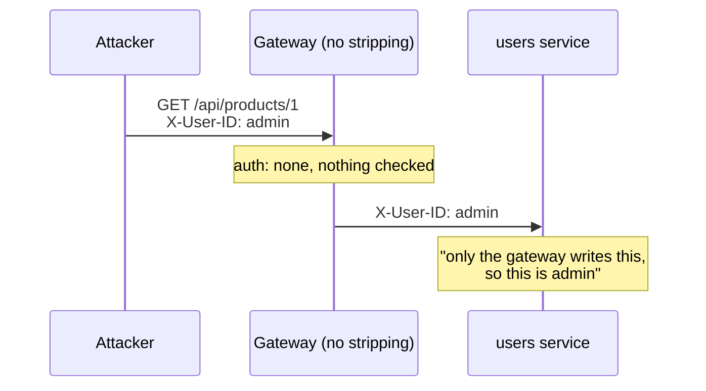

**With stripping**, the gateway is the only possible author:

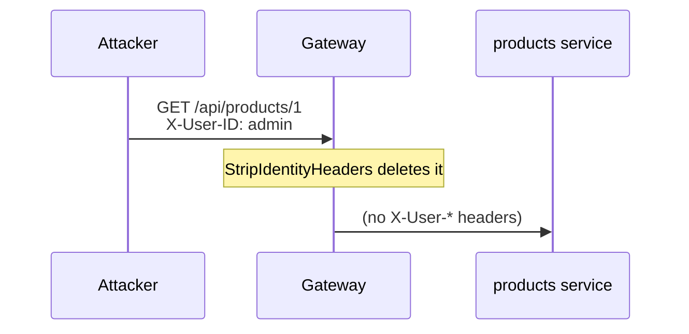

Validating the JWT only protects requests that present a token. An attacker who
skips the token never reaches the validator. Stripping is what makes the header
trustworthy at all.

---

## 4. Code walkthrough

### The handler chain

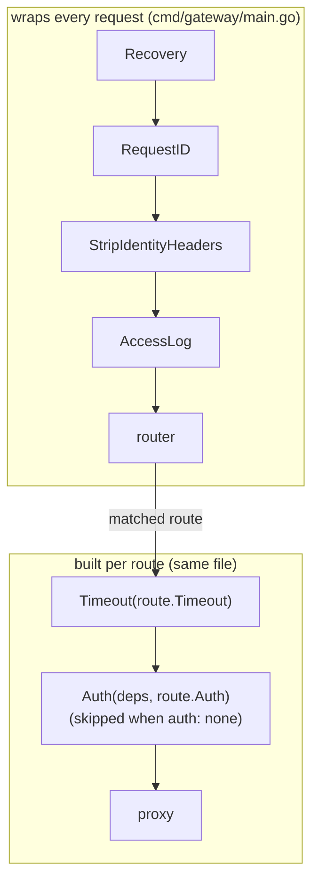

Why is `Auth` wrapped per route and not global? The policy is a property of the
**route**, and the route is only known after the router has matched. A global
layer runs before routing and cannot know it. `StripIdentityHeaders` has no such
need, so it is global and runs for every request, whatever the policy.

### `internal/middleware/stripidentity.go`

Deletes every inbound header whose name, lower-cased with `_` treated as `-`,
starts with `x-user-`. Prefix matching means a future `X-User-Email` is covered
automatically. The `_` rule exists because CGI-style backends (WSGI, PHP) map
`X_User_ID` and `X-User-ID` to the same variable, so a filter that only knew the
dash form could be bypassed.

### `internal/middleware/auth.go`

```go
type KeySource interface {
    Key(token *jwt.Token) (any, error)
}
```

This interface is the seam that makes RS256 an addition and not a rewrite. The
middleware doesn't care where the key comes from.

| Piece | What it does |
|---|---|
| `StaticKey` | A `[]byte` that always returns itself. The HS256 key source |
| `AuthDependencies` | Everything `Auth` needs: key source, algorithm, issuer, audience, leeway |
| `UserClaims` | `jwt.RegisteredClaims` (sub, iss, aud, exp...) plus `Roles []string` |
| `Auth(deps, policy)` | Returns a `Middleware`. The parser is built once, outside the per-request function |

The parser options are the whole security configuration:

```go
jwt.NewParser(
    jwt.WithValidMethods([]string{a.Algorithm}), // pin alg from CONFIG
    jwt.WithLeeway(a.Leeway),                    // clock skew
    jwt.WithIssuer(a.Issuer),
    jwt.WithAudience(a.Audience),
    jwt.WithExpirationRequired(),                // missing exp = rejected
)
```

Request flow inside the closure:

1. `none` returns `next` unchanged at build time (no per-request cost).
2. No `Authorization` header: `optional` passes through, `required` gets a bare
   `WWW-Authenticate: Bearer` challenge.
3. Scheme check: case-insensitive **prefix** `bearer ` (RFC 7235). The first
   draft used `strings.Cut(header, "Bearer ")`, which also matched
   `X Bearer <token>`.
4. `ParseWithClaims(token, &claims, a.Keys.Key)`: verifies everything in the
   flowchart in section 1.
5. Require a non-empty `sub`, then set `X-User-ID` and `X-User-Roles`.

### `internal/config/config.go`

| Piece | What it does |
|---|---|
| `Auth` struct | `algorithm`, `secret_env`, `issuer`, `audience`, `leeway`, and `Secret` (`yaml:"-"`, never read from the file) |
| `route.Auth` default | Empty becomes `required`. Opening a route needs an explicit `auth: none` |
| `resolveSecrets` | Reads the secret from the environment variable named by `secret_env`. Refuses unset/empty and anything under 32 bytes (RFC 7518 floor for HS256). The error names the variable and the byte count, **never the secret** |

The secret lives in the environment, not the YAML, because the YAML is in git.

---

## 5. HS256 vs RS256, and why authsvc exists

### HS256: one shared secret

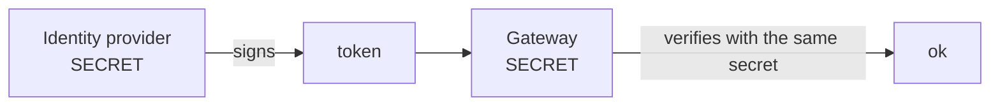

Simple, but the gateway holds the signing secret, so a **compromised gateway
can forge a token for anyone**. Today, in your tests, you play the identity
provider: `mkToken` signs with the same secret the gateway has.

### RS256: private signs, public verifies

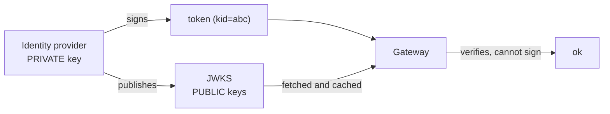

The gateway can verify tokens but cannot create them. The cost is a new
question: how does the gateway get the public key, and what happens when it
changes? That is JWKS.

### What authsvc is

`cmd/authsvc/main.go` is a **test fixture**, like `toysvc` is for backends. It
plays the identity provider so the RS256 path has something real to talk to.
It is insecure on purpose: it hands a token to anyone who asks.

| Endpoint | Real-world equivalent |
|---|---|
| `POST /token?sub=alice&roles=admin,dev&ttl=10m` | The user logs in and receives a token (the password check is skipped). A negative `ttl` mints an already-expired token for tests |
| `GET /.well-known/jwks.json` | Publishes the public keys: the current one plus recently retired ones |
| `POST /rotate` | The provider changes its signing key. The old key stays in the JWKS for `-retire-after` |
| `POST /rotate?drop_old=true` | Rotates and removes retired keys at once, to test a token whose key is gone |

How it is built:

- A `keyring` (behind one mutex) holds the **current** key and a list of
  **retired** ones. `/token` always signs with the current key and stamps its
  `kid` in the header. The JWKS handler returns current + retired-and-still-fresh.
- Each JWK is `{kty:"RSA", use:"sig", alg:"RS256", kid, n, e}`. `n` (modulus) and
  `e` (exponent, 65537 = `AQAB`) are big-endian bytes, base64url **without
  padding**.
- Rotation keeps the old key published so tokens already in flight still verify.
  Without that grace period, every rotation would log everyone out.

I verified one of its tokens independently: rebuilt the public key from the
JWKS `n` and `e` and checked the signature with `openssl`. It said
`Verified OK`.

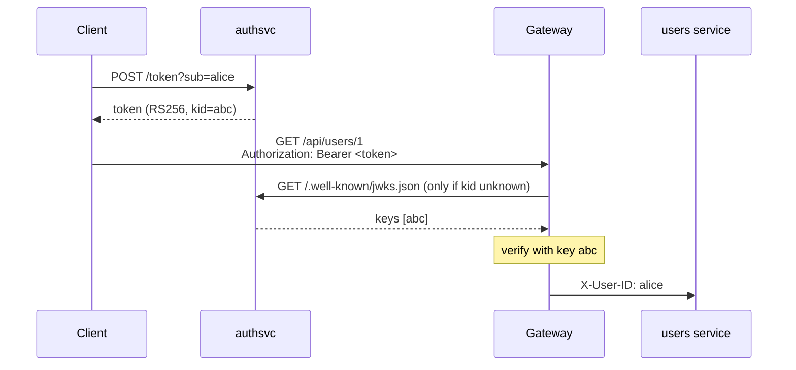

---

## 6. The JWKS key source

This is the gateway-side code in `internal/middleware/jwks.go`. It implements
the existing `KeySource` interface: `Key(token) (any, error)`. The config and
`main.go` wiring at the end of this section are still to do.

### What `Key()` has to do, in this order

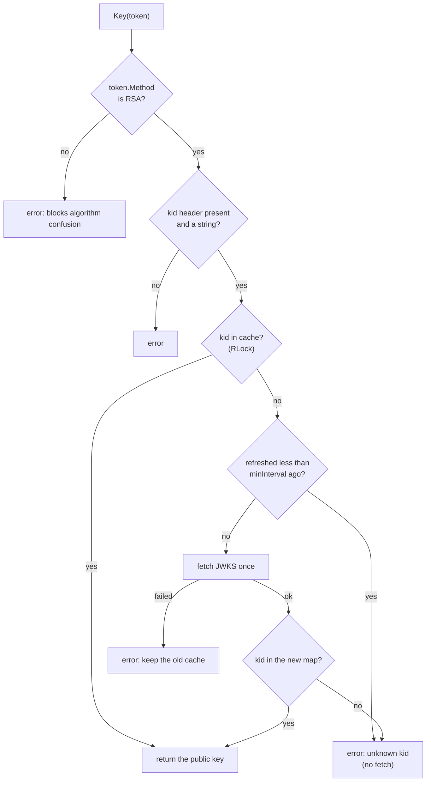

The order is the security property: the method check comes before any key
lookup, so an HS256 token can never be verified with an RSA public key as if it
were a secret.

### The problems it must solve

| Problem | Why it matters | Approach |
|---|---|---|
| Unknown-`kid` flood | A client sending random `kid`s would make every request hit authsvc | Minimum interval between fetches, updated on failures too |
| Concurrent refreshes | 100 requests with the same new `kid` should cause one fetch | Re-check under the write lock, or `singleflight` |
| Network I/O under a lock | A slow authsvc would stall every request | Fetch and parse first, take the lock only to swap the map |
| Half-built cache | Readers must never see a partial map | Build a complete new map, then swap |
| Hostile responses | A huge or non-200 body | `io.LimitReader`, require status 200 |
| authsvc is down | An outage there must not become an outage here | **Decision to record:** keep serving cached keys; only an unknown `kid` fails (closed) |

### Why a cache that refreshes only on an unknown `kid`

Two simple designs both fail:

| Design | Why it fails |
|---|---|
| Fetch the JWKS on every request | Every request to the gateway now needs a second network call. Slow, and an authsvc outage becomes a gateway outage |
| Fetch once at startup | Key rotation breaks everything until the gateway restarts |

So the gateway **caches** the keys and refreshes **only when it meets a `kid` it
does not know**. An unknown `kid` means one of two things: the IdP rotated, or
someone is sending a forged token. The code cannot tell which, so it tries one
refresh (rate-limited) and sees if the `kid` shows up.

### What the code in `jwks.go` looks like

Two locks with two different jobs:

| Field | Type | Guards | Held for |
|---|---|---|---|
| `mu` | `RWMutex` | the `keys` map | nanoseconds: one map read or one pointer swap. Never across I/O |
| `fetchMu` | `Mutex` | refreshes, and `lastFetch` | the whole refresh, including the HTTP call |

A request for an already cached `kid` takes only `mu.RLock`. It never touches
`fetchMu`, so a slow authsvc cannot slow it down. Only requests with an unknown
`kid` queue on `fetchMu`.

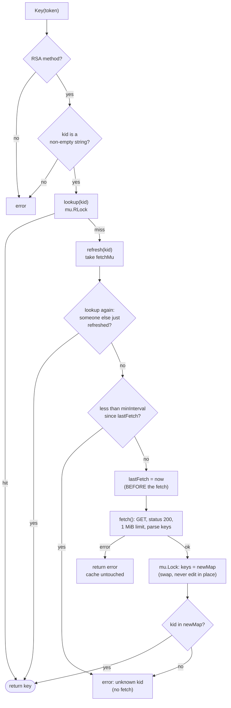

Function by function:

| Function | What it does |
|---|---|
| `NewJWKS(url, minInterval)` | Builds the struct with an **empty** (not nil) map, a 10 s HTTP timeout (a hung authsvc must not hang a goroutine forever), and `now = time.Now`. `now` is a field so tests can move the clock instead of sleeping |
| `Key(token)` | The `KeySource` method the JWT library calls: "which key verifies this token?". Checks the method and `kid`, tries the cache, falls back to `refresh` |
| `lookup(kid)` | `RLock`, read the map, unlock. `nil` if missing |
| `refresh(kid)` | The slow path (see the flowchart): lock, re-check, rate-limit, stamp, fetch, swap, look in the new map |
| `fetch()` | `GET`, require 200, decode at most 1 MiB, keep only `kty:"RSA"` keys with a `kid` and a valid `n`/`e`, **skip** bad entries, fail if zero keys remain |
| `parseRSAKey(n, e)` | base64url-decode `n` and `e` (no padding), turn the bytes into big integers, check the exponent is sane, build an `rsa.PublicKey` |

### The reasoning behind each design choice

| Choice | Why |
|---|---|
| Method check **first**, before any key lookup | An `HS256` token must never be verified with an RSA public key used as an HMAC secret (algorithm confusion). `Auth()` also pins the algorithm with `WithValidMethods`; this is a second layer |
| Re-check the cache after taking `fetchMu` | Turns 100 concurrent requests for the same new `kid` into **one** fetch: the other 99 wake up one at a time and find the key already cached |
| `lastFetch` is stamped **before** the fetch | Failures must count. Otherwise a dead authsvc is hit once per request instead of once per `minInterval` |
| Fetch with `mu` **not** held | Holding a lock across the network lets one slow response freeze every request. The first draft held `RLock` across the call, which would also have **deadlocked** when the write step was added: Go cannot upgrade a read lock to a write lock |
| Build a whole new map and swap | Readers see the old complete map or the new complete map, never a half-built one. Nothing mutates a shared map in place |
| Keep the old cache when a fetch fails | authsvc being down must not log out everyone who already has a cached key. Only an unknown `kid` fails (closed) |
| Zero usable keys counts as a fetch failure | A buggy `{"keys":[]}` would otherwise wipe the cache and lock everyone out. Cost: you cannot revoke *all* keys with an empty set |
| Status 200 and a 1 MiB read limit | A 500 HTML page would otherwise become a misleading JSON error, and a hostile endpoint could stream gigabytes into memory |
| Skip a bad key instead of failing the document | One malformed entry should not discard the good ones |

### Behaviour over time (`minInterval = 60s`)

| Time | Event | What the gateway does |
|---|---|---|
| 0:00 | First token, `kid=A` | Cache empty: fetch, cache `{A}`, verify |
| 0:05 | 10,000 tokens, `kid=A` | Cache hits. No network |
| 1:00 | authsvc rotates: new key `B`, `A` retired but still published | Nothing yet: the gateway does not know |
| 1:01 | First token with `kid=B` | Miss. More than 60 s since the last fetch: fetch, cache `{A,B}`, verify |
| 1:01 | 100 simultaneous `kid=B` tokens | One fetch. The other 99 wait on `fetchMu` and then hit the cache |
| 1:02 | Attacker sends `kid=junk` | Miss. Less than 60 s since the last fetch: **rejected, no fetch** |
| 2:10 | `kid=junk` again | Interval passed: one fetch, still not there, rejected |
| any | authsvc is down | Cached kids keep verifying. A new `kid` fails |

### What each test proves (`jwks_test.go`)

| Test | Proves |
|---|---|
| `FetchCacheAndRotation` | Cached after the first fetch; a rotated-in key is picked up, but only after `minInterval` |
| `FloodOfRandomKids` | 50 junk kids cause 1 fetch |
| `Stampede` | 100 concurrent callers cause 1 fetch (run with `-race`) |
| `OutageKeepsCache` | During a 500: cached kids work, unknown kids fail |
| `RejectsNonRSAAndMissingKid` | The algorithm-confusion and missing-`kid` guards |

---

### Key rotation in depth

#### What it is, in one paragraph

The IdP holds a private key and signs every token with it. **Rotation** means
the IdP starts signing with a *different* private key (a new `kid`) and, after a
grace period, stops publishing the old public key. Nothing about the tokens'
format changes: only the key behind the signature, and the `kid` that names it.

#### When does rotation happen?

There is no universal answer. It is a policy decision, and `authsvc` has no
schedule at all: it rotates only when you `POST /rotate` (or restart it).

| Trigger | Example | Urgency | Old key |
|---|---|---|---|
| **Scheduled hygiene** | Every few weeks or months, by company policy | Low | Keep through a grace period |
| **Suspected compromise** | The private key leaked, a server was breached, someone with access left | **Immediate** | Remove at once (`drop_old`) |
| **Cryptographic upgrade** | Moving from 2048 to 3072-bit keys, or to a different algorithm | Planned | Keep through a grace period |
| **Infrastructure change** | Moving to new hardware, or an IdP whose keys live in memory restarts | Varies | Often lost by accident |

Why rotate on a schedule if nothing is wrong? It **limits the damage window**
of a key that was stolen without anyone noticing, and it keeps the procedure
practised: a rotation you do monthly is routine, one you do for the first time
during a breach is not.

#### How it works: the life of one key

Careful IdPs move a key through four phases:

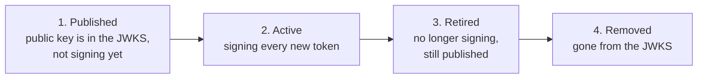

- **1 → 2 (pre-publish)** gives every gateway time to cache the new key *before*
  the first token that uses it exists.
- **3 (retired)** exists because tokens are valid for a while after they are
  signed. A token signed one second before the switch is still good for its full
  lifetime.
- **4** happens only when no valid token signed by that key can still exist.

`authsvc` simplifies this: `POST /rotate` does phases 1 and 2 **in one step**
(the new key is published and signing immediately), then keeps the old key in
phase 3 for `-retire-after`, then drops it. It is simpler, and it is exactly why
the gateway must be able to discover a new `kid` on demand.

I ran this against the real `authsvc` with `-retire-after 4s`:

```
start:   kid cb2a...                    (one key)
rotate:  new kid 0d22...
after:   0d22... cb2a...                (new + retired, both published)
+5s:     0d22...                        (retired key dropped)
drop:    POST /rotate?drop_old=true -> only the newest kid is left
```

#### The rule for the grace period

> The retired key must stay published for **at least the longest lifetime of
> any token it signed** (plus a margin for caches and clock differences).

Check this against your own defaults: `authsvc` has `-ttl 15m` but
`-retire-after 10m`. A token minted one second before a rotation is valid
(`exp`) for 15 minutes, but its key leaves the JWKS after 10. Once the gateway
refreshes after that point, the token is rejected with about 5 minutes of life
left. For lab runs, either use `-retire-after 20m` or a shorter `-ttl`.

#### What rotation does to the gateway

**The normal case.** The gateway is not told about a rotation. It finds out
when a token with a new `kid` arrives:

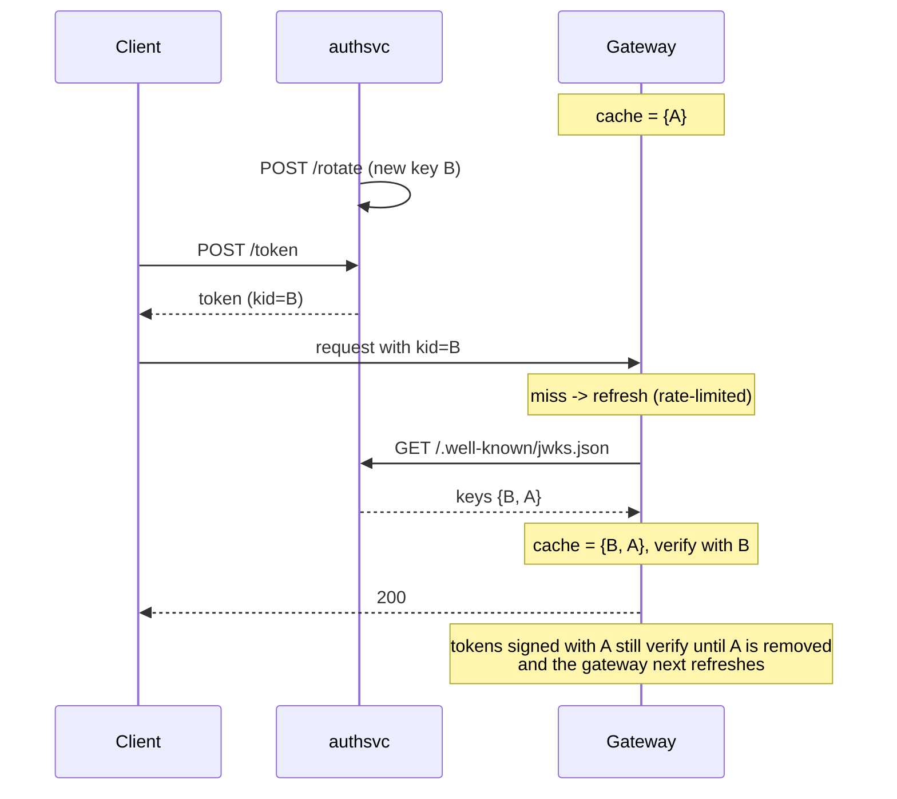

Everything else follows from that one mechanism. These are the behaviours to
know, including the two edge cases that can bite:

| Situation | What the gateway does | What the client sees |
|---|---|---|
| Rotation, new `kid` appears, interval has passed | One fetch, then verifies | The first request is slightly slower (one fetch); then normal |
| 100 requests with the new `kid` at once | One fetch; the rest wait, then hit the cache | All succeed |
| **Rotation soon after the last fetch** (inside `minInterval`) | Refuses to fetch: unknown `kid` | **A valid token gets 401** until the interval passes |
| Retired key removed from the JWKS | The old key stays cached until the *next* refresh, then disappears | Tokens signed with it start failing 401, which is correct |
| `drop_old` / emergency rotation | **Does not notice** until an unknown `kid` arrives (see below) | Old tokens keep working for a while |
| authsvc is down during a rotation | Keeps the cache; the new `kid` cannot be fetched | New-key tokens get 401; old-key tokens keep working |
| authsvc **restarts** | Its keys are in memory, so this is a `drop_old` rotation | Every outstanding token fails after the next gateway refresh; users must get a new one |
| Gateway restarts | Cache is empty; the first request fetches | Nothing visible (the planned startup fetch will surface a bad URL immediately) |

**Edge case 1: valid tokens rejected right after a rotation.**
`minInterval` protects authsvc from a flood of junk `kid`s, but it cannot tell a
junk `kid` from a real new one. Example: the gateway fetches at 0:00, authsvc
rotates at 0:05, and a user logs in at 0:10 and gets a `kid=B` token. With
`minInterval = 60s` the gateway answers 401 until 1:00 even though the token is
perfectly valid. This is the price of the flood protection. Ways to soften it:
a shorter interval (`jwks_refresh`), pre-publishing the new key before it signs,
and clients that retry once on 401. It is worth logging this case as "unknown
kid, refresh suppressed" so it is not mistaken for a bad token.

**Edge case 2: a removed or compromised key is trusted too long.**
The cache has no expiry. The gateway only looks at the JWKS again when it sees
an unknown `kid`. After an emergency `drop_old` rotation, the gateway keeps
accepting tokens signed by the compromised key **until some request with a new
`kid` triggers a refresh**. In practice that happens as soon as any legitimate
user gets a post-rotation token and calls the gateway, but it is not
guaranteed. If that window is unacceptable, the fix is a maximum cache age or a
background refresh. This is a design decision to record in the notes: the
current plan is "refresh only on unknown `kid`", which favours simplicity and a
quiet IdP over fast revocation.

`authsvc` also sends `Cache-Control: public, max-age=60` on the JWKS. The
gateway ignores it: it decides its own refresh policy.

#### Try it yourself

The JWKS side needs only `authsvc` and `curl` (the gateway's RS256 config is
not wired up yet):

```bash
go run ./cmd/authsvc -retire-after 30s &
curl -s localhost:9100/.well-known/jwks.json          # one key
curl -s -X POST 'localhost:9100/token?sub=alice'      # note the kid
curl -s -X POST localhost:9100/rotate                 # new current key
curl -s localhost:9100/.well-known/jwks.json          # two keys: new + retired
sleep 35
curl -s localhost:9100/.well-known/jwks.json          # the retired key is gone
```

The gateway side is covered by the unit tests, which move the clock with `j.now`
instead of waiting: run `go test -race -run JWKS -v ./internal/middleware/`.

---

### Config and wiring

Done, and checked with real processes (`scripts/m5-rs256-experiments.sh`).

- `Auth` has `jwks_url` and `jwks_refresh`. `jwks_refresh` is the `minInterval`
  of the key source; it defaults to `1m` when RS256 leaves it out.
- `Validate`: `algorithm` must be `HS256` or `RS256`; `RS256` requires an
  absolute `http(s)` `jwks_url` and a non-negative `jwks_refresh`; `HS256`
  rejects `jwks_url` and `jwks_refresh` (a config with both is almost certainly a
  mistake). The error never echoes the URL, which could carry credentials.
- `secret_env` is only required for HS256 (`resolveSecrets` skips other
  algorithms).
- `main.go` has `newKeySource`, a switch on the algorithm: `StaticKey` for HS256,
  `NewJWKS` for RS256. For RS256 it calls `Prime()` once at startup and the
  gateway **refuses to start** if that fails (`initial JWKS fetch: ...`).
  `Prime()` shares `fetchAndStore` with the refresh path, so both stamp
  `lastFetch` and swap the cache the same way.

---

## 7. The tests and the experiment script

### Unit tests: `internal/middleware/auth_test.go`

A table over **policy x token** cells. Writing the table is what exposed the
inverted condition in the first draft (`authHeader != "" && policy == "required"`
returned 401 for valid tokens).

| Token | `required` | `optional` | `none` |
|---|---|---|---|
| none | 401 | 200 | 200 |
| valid | 200 | 200 | 200 |
| wrong key | 401 | | |
| expired | 401 | | |
| HS512 (wrong alg) | 401 | | |
| `alg: none` (hand-built) | 401 | 401 | |
| no `exp` | 401 | 401 | |
| garbage | | 401 | 200 (ignored) |
| `Basic ...`, `X Bearer ...` | 401 | | |

Two of these have a different number of defences:

- **`alg: none`**: two. The pinned algorithm **and** the library, which refuses
  `none` unless the key is the special `UnsafeAllowNoneSignatureType`.
- **no `exp`**: **one**, `WithExpirationRequired()`. Removing it makes both
  `no exp` rows fail (checked), because the library's default treats a missing
  `exp` as "never expires".

### End-to-end: `internal/router/auth_e2e_test.go`

Builds the same chain as `main.go` in front of a fake upstream that echoes the
identity headers it received and counts hits. It proves the upstream is **never
hit** on a 401, and that forged `X-User-*` never arrive.

### Real processes: `scripts/m5-experiments.sh`

The Go tests bypass `config.Load`, so the script starts real `toysvc` and
`gateway` processes (with a temp config, secret from the environment) and curls
them with tokens signed by `openssl`, which shares no code with the gateway.

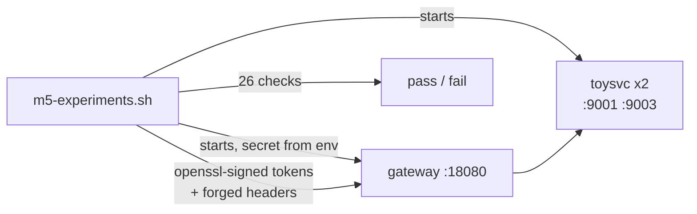

26/26 pass. Startup cases are covered too: the gateway refuses to start with the
secret unset or under 32 bytes, naming the variable and the byte count but never
the secret.

---

## 8. What to remember

- **The gateway verifies; the identity provider issues.** The gateway never sees
  passwords.
- **Header stripping and token verification are one mechanism**, not two. The
  token check protects requests that carry a token; stripping protects the ones
  that don't. Without stripping, the verification protects nothing the upstream
  actually relies on.
- **Never trust the token about itself.** `alg` comes from config, not from the
  token. Same reason for the order of checks in `Key()`: method first.
- **A guard needs a test that fails without it.** The no-`exp` row only means
  something because removing `WithExpirationRequired()` turns it red.
- **HS256 means the gateway can forge tokens; RS256 means it cannot.** That is
  the reason to pay for JWKS.
- **A key source must degrade gracefully.** authsvc being down should hurt only
  the requests that need a key the gateway has never seen.
- **Zero-trust question (open):** should upstreams also verify the token instead
  of trusting `X-User-*`? Trust is simpler (one place holds keys). Verifying
  limits the damage of a bypassed gateway or a mis-routed internal call. Know
  both sides for the review.
