# M5: What I coded, explained

An explanation of the M5 code (authentication at the edge), from the core
concepts down to the code, plus how the toy identity provider `authsvc` fits in.

> **Status.** HS256 verification, header stripping, the three route policies,
> the tests and the real-process script are done and committed. `authsvc` is
> drafted. The gateway-side JWKS key source (`internal/middleware/jwks.go`) and
> the RS256 config are **not built yet**; section 6 describes them as the plan,
> not as existing code.

**Contents**

1. [Core concepts](#1-core-concepts)
2. [The life of a request](#2-the-life-of-a-request)
3. [Why stripping headers matters as much as verifying](#3-why-stripping-headers-matters-as-much-as-verifying)
4. [Code walkthrough](#4-code-walkthrough)
5. [HS256 vs RS256, and why authsvc exists](#5-hs256-vs-rs256-and-why-authsvc-exists)
6. [The JWKS key source (still to build)](#6-the-jwks-key-source-still-to-build)
7. [The tests and the experiment script](#7-the-tests-and-the-experiment-script)
8. [What to remember](#8-what-to-remember)

---

## 1. Core concepts

### The problem M5 solves

Your backend services (users, orders) need to know **who is calling**. If every
service verified passwords and tokens itself, each would need the keys and the
verification code. Instead, the gateway verifies identity **once**, at the edge,
and tells the services the result in a header.


The whole design rests on one promise: **only the gateway can write
`X-User-*`**. Section 3 is about keeping that promise.

### Key terms

| Term | Meaning |
|---|---|
| **Identity provider (IdP)** | The system that logs users in and **issues** tokens (Auth0, Keycloak, Google). Never the gateway. `authsvc` is a toy one |
| **JWT** | A token of three parts: `header.payload.signature`. Anyone can read it; nobody can change it without breaking the signature |
| **Claims** | The fields in the payload: `sub` (who), `iss` (who issued it), `aud` (who it is for), `exp` (when it expires), plus custom ones like `roles` |
| **Signature** | Proof the IdP produced the token. The gateway checks it before believing any claim |
| **`alg`** | The signing algorithm, named in the token's header. It is **attacker-controlled**, so the gateway must not trust it (see below) |
| **HS256** | Symmetric: one shared secret both signs and verifies |
| **RS256** | Asymmetric: a private key signs, a public key verifies |
| **JWKS** | A JSON document at a URL listing the IdP's public keys |
| **`kid`** | "Key ID". The token says which key signed it, so the gateway can pick the right one from the JWKS |
| **Key rotation** | Replacing the signing key regularly (or after a leak) without downtime |
| **Policy** | Per route: `required` (valid token or 401), `optional` (anonymous allowed, but a bad token is 401), `none` (no checks) |

### What the gateway checks on every token

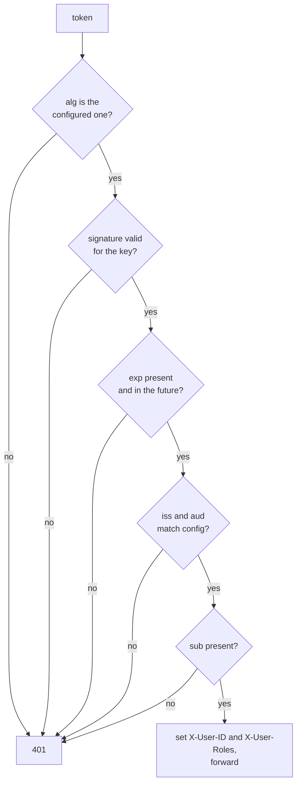

Each box is a real attack if you skip it:

| Skipped check | What an attacker does |
|---|---|
| Pinned `alg` | Sends `alg: none` (no signature at all), or flips RS256 to HS256 so the public key is used as an HMAC secret |
| Signature | Edits `sub` to `admin` |
| `exp` present | A leaked token with no `exp` lives forever |
| `iss` / `aud` | Replays a token issued for a different system |

---

## 2. The life of a request

### With a valid token (policy `required`)

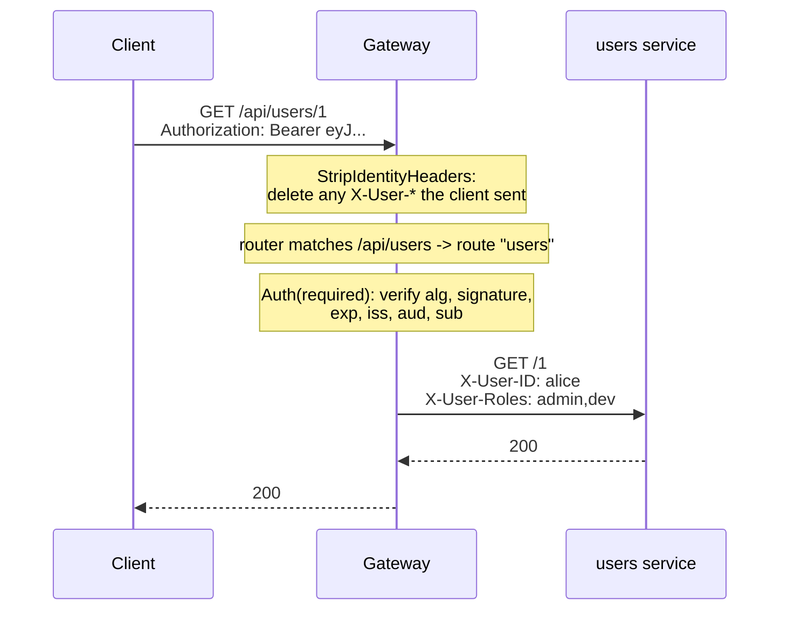

### With no token, or a bad one

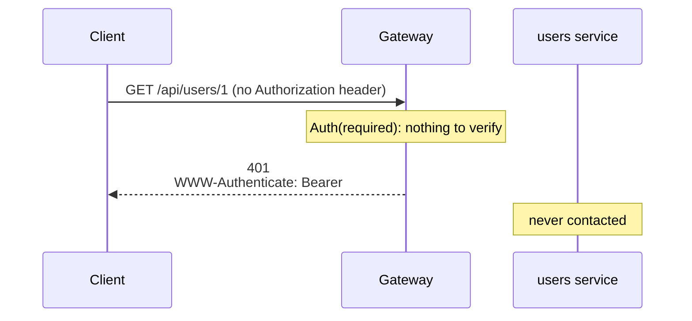

A bad token gets `WWW-Authenticate: Bearer error="invalid_token", ...`. The
description text is fixed in the code, never copied from the client, so the
header can't be injected into.

### The three policies

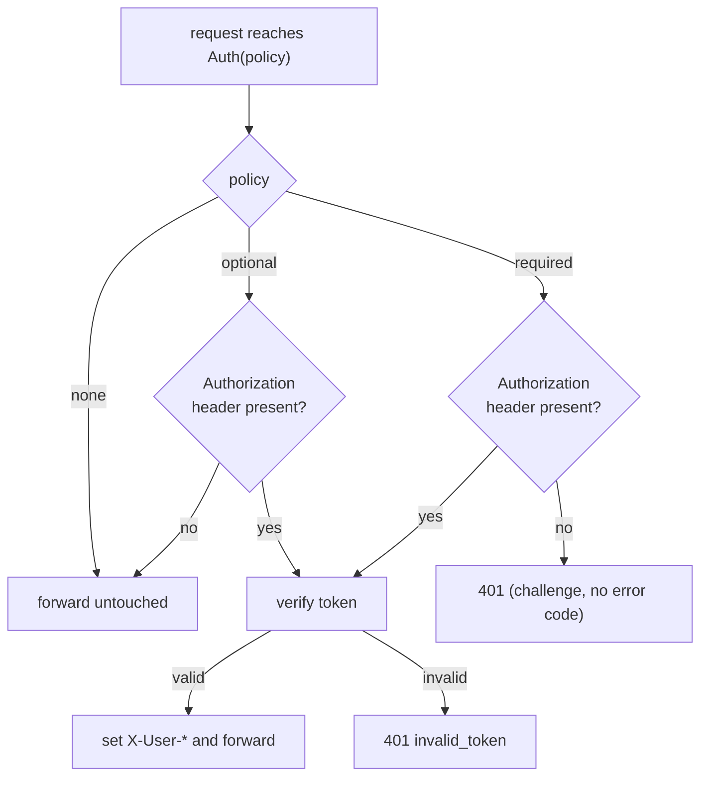

The design decision worth remembering: under `optional`, a present-but-invalid
token is **401, not anonymous**. A bad token is almost always a client bug
(expired, wrong key). Quietly downgrading to anonymous would show the user as
"logged out" with no error to debug.

---

## 3. Why stripping headers matters as much as verifying

HTTP headers are plain text. Anyone can send `X-User-ID: admin`.

**Without stripping**, on a route with `auth: none` (or `optional` with no
token), no verification runs, so the forged header goes straight through:

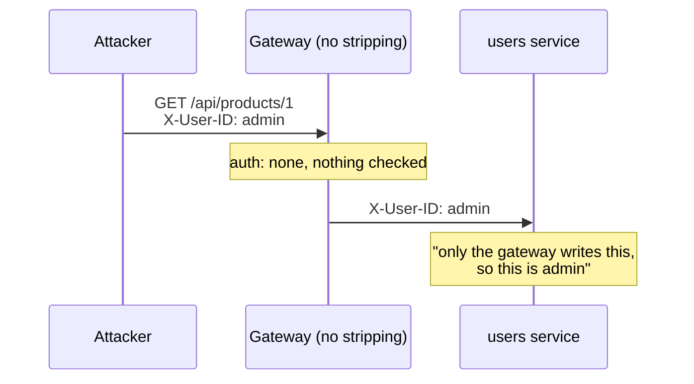

**With stripping**, the gateway is the only possible author:

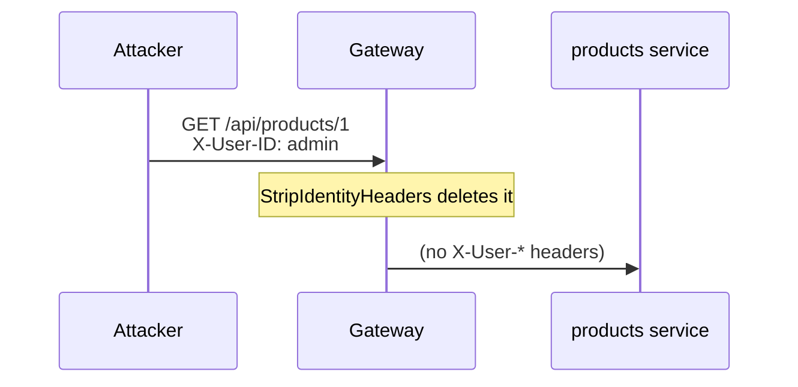

Validating the JWT only protects requests that present a token. An attacker who
skips the token never reaches the validator. Stripping is what makes the header
trustworthy at all.

---

## 4. Code walkthrough

### The handler chain

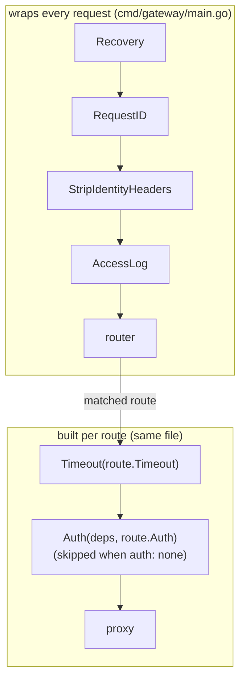

Why is `Auth` wrapped per route and not global? The policy is a property of the
**route**, and the route is only known after the router has matched. A global
layer runs before routing and cannot know it. `StripIdentityHeaders` has no such
need, so it is global and runs for every request, whatever the policy.

### `internal/middleware/stripidentity.go`

Deletes every inbound header whose name, lower-cased with `_` treated as `-`,
starts with `x-user-`. Prefix matching means a future `X-User-Email` is covered
automatically. The `_` rule exists because CGI-style backends (WSGI, PHP) map
`X_User_ID` and `X-User-ID` to the same variable, so a filter that only knew the
dash form could be bypassed.

### `internal/middleware/auth.go`

```go
type KeySource interface {
    Key(token *jwt.Token) (any, error)
}
```

This interface is the seam that makes RS256 an addition and not a rewrite. The
middleware doesn't care where the key comes from.

| Piece | What it does |
|---|---|
| `StaticKey` | A `[]byte` that always returns itself. The HS256 key source |
| `AuthDependencies` | Everything `Auth` needs: key source, algorithm, issuer, audience, leeway |
| `UserClaims` | `jwt.RegisteredClaims` (sub, iss, aud, exp...) plus `Roles []string` |
| `Auth(deps, policy)` | Returns a `Middleware`. The parser is built once, outside the per-request function |

The parser options are the whole security configuration:

```go
jwt.NewParser(
    jwt.WithValidMethods([]string{a.Algorithm}), // pin alg from CONFIG
    jwt.WithLeeway(a.Leeway),                    // clock skew
    jwt.WithIssuer(a.Issuer),
    jwt.WithAudience(a.Audience),
    jwt.WithExpirationRequired(),                // missing exp = rejected
)
```

Request flow inside the closure:

1. `none` returns `next` unchanged at build time (no per-request cost).
2. No `Authorization` header: `optional` passes through, `required` gets a bare
   `WWW-Authenticate: Bearer` challenge.
3. Scheme check: case-insensitive **prefix** `bearer ` (RFC 7235). The first
   draft used `strings.Cut(header, "Bearer ")`, which also matched
   `X Bearer <token>`.
4. `ParseWithClaims(token, &claims, a.Keys.Key)`: verifies everything in the
   flowchart in section 1.
5. Require a non-empty `sub`, then set `X-User-ID` and `X-User-Roles`.

### `internal/config/config.go`

| Piece | What it does |
|---|---|
| `Auth` struct | `algorithm`, `secret_env`, `issuer`, `audience`, `leeway`, and `Secret` (`yaml:"-"`, never read from the file) |
| `route.Auth` default | Empty becomes `required`. Opening a route needs an explicit `auth: none` |
| `resolveSecrets` | Reads the secret from the environment variable named by `secret_env`. Refuses unset/empty and anything under 32 bytes (RFC 7518 floor for HS256). The error names the variable and the byte count, **never the secret** |

The secret lives in the environment, not the YAML, because the YAML is in git.

---

## 5. HS256 vs RS256, and why authsvc exists

### HS256: one shared secret

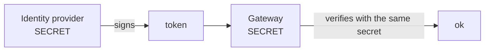

Simple, but the gateway holds the signing secret, so a **compromised gateway
can forge a token for anyone**. Today, in your tests, you play the identity
provider: `mkToken` signs with the same secret the gateway has.

### RS256: private signs, public verifies

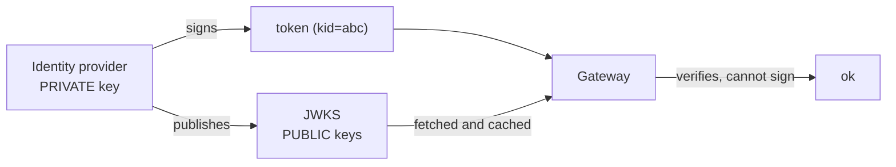

The gateway can verify tokens but cannot create them. The cost is a new
question: how does the gateway get the public key, and what happens when it
changes? That is JWKS.

### What authsvc is

`cmd/authsvc/main.go` is a **test fixture**, like `toysvc` is for backends. It
plays the identity provider so the RS256 path has something real to talk to.
It is insecure on purpose: it hands a token to anyone who asks.

| Endpoint | Real-world equivalent |
|---|---|
| `POST /token?sub=alice&roles=admin,dev&ttl=10m` | The user logs in and receives a token (the password check is skipped). A negative `ttl` mints an already-expired token for tests |
| `GET /.well-known/jwks.json` | Publishes the public keys: the current one plus recently retired ones |
| `POST /rotate` | The provider changes its signing key. The old key stays in the JWKS for `-retire-after` |
| `POST /rotate?drop_old=true` | Rotates and removes retired keys at once, to test a token whose key is gone |

How it is built:

- A `keyring` (behind one mutex) holds the **current** key and a list of
  **retired** ones. `/token` always signs with the current key and stamps its
  `kid` in the header. The JWKS handler returns current + retired-and-still-fresh.
- Each JWK is `{kty:"RSA", use:"sig", alg:"RS256", kid, n, e}`. `n` (modulus) and
  `e` (exponent, 65537 = `AQAB`) are big-endian bytes, base64url **without
  padding**.
- Rotation keeps the old key published so tokens already in flight still verify.
  Without that grace period, every rotation would log everyone out.

I verified one of its tokens independently: rebuilt the public key from the
JWKS `n` and `e` and checked the signature with `openssl`. It said
`Verified OK`.

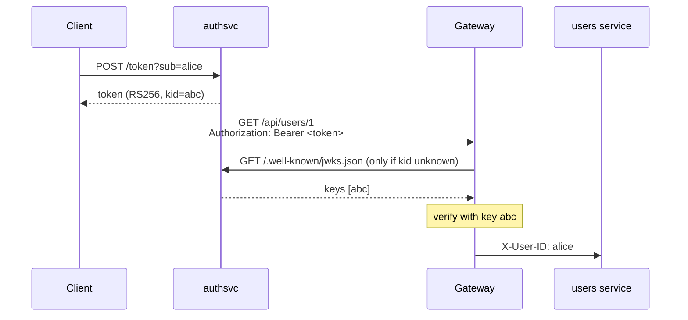

---

## 6. The JWKS key source (still to build)

This is the gateway-side code that is **not written yet**. It will implement
the existing `KeySource` interface: `Key(token) (any, error)`.

### What `Key()` has to do, in this order

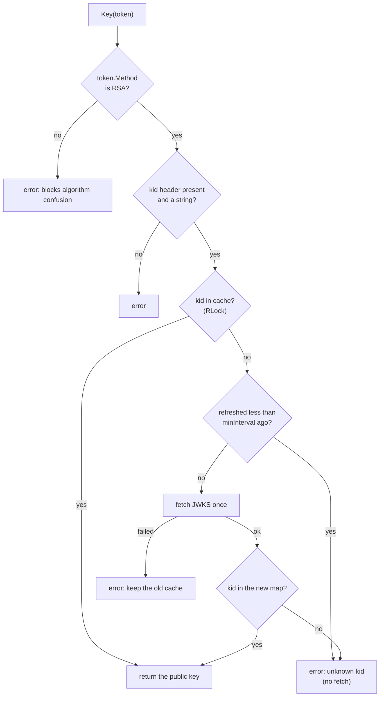

The order is the security property: the method check comes before any key
lookup, so an HS256 token can never be verified with an RSA public key as if it
were a secret.

### The problems it must solve

| Problem | Why it matters | Approach |
|---|---|---|
| Unknown-`kid` flood | A client sending random `kid`s would make every request hit authsvc | Minimum interval between fetches, updated on failures too |
| Concurrent refreshes | 100 requests with the same new `kid` should cause one fetch | Re-check under the write lock, or `singleflight` |
| Network I/O under a lock | A slow authsvc would stall every request | Fetch and parse first, take the lock only to swap the map |
| Half-built cache | Readers must never see a partial map | Build a complete new map, then swap |
| Hostile responses | A huge or non-200 body | `io.LimitReader`, require status 200 |
| authsvc is down | An outage there must not become an outage here | **Decision to record:** keep serving cached keys; only an unknown `kid` fails (closed) |

### Config and wiring still needed

- `Auth` gets `jwks_url` and `jwks_refresh`.
- `Validate`: `algorithm` must be `HS256` or `RS256`; `RS256` requires an
  `http(s)` `jwks_url`; `HS256` rejects `jwks_url` (a config with both is almost
  certainly a mistake).
- `secret_env` is only required for HS256 (`resolveSecrets` already skips others).
- `main.go` replaces the hard-coded `middleware.StaticKey(...)` with a switch on
  the algorithm. If the first JWKS fetch fails, the gateway refuses to start.

---

## 7. The tests and the experiment script

### Unit tests: `internal/middleware/auth_test.go`

A table over **policy x token** cells. Writing the table is what exposed the
inverted condition in the first draft (`authHeader != "" && policy == "required"`
returned 401 for valid tokens).

| Token | `required` | `optional` | `none` |
|---|---|---|---|
| none | 401 | 200 | 200 |
| valid | 200 | 200 | 200 |
| wrong key | 401 | | |
| expired | 401 | | |
| HS512 (wrong alg) | 401 | | |
| `alg: none` (hand-built) | 401 | 401 | |
| no `exp` | 401 | 401 | |
| garbage | | 401 | 200 (ignored) |
| `Basic ...`, `X Bearer ...` | 401 | | |

Two of these have a different number of defences:

- **`alg: none`**: two. The pinned algorithm **and** the library, which refuses
  `none` unless the key is the special `UnsafeAllowNoneSignatureType`.
- **no `exp`**: **one**, `WithExpirationRequired()`. Removing it makes both
  `no exp` rows fail (checked), because the library's default treats a missing
  `exp` as "never expires".

### End-to-end: `internal/router/auth_e2e_test.go`

Builds the same chain as `main.go` in front of a fake upstream that echoes the
identity headers it received and counts hits. It proves the upstream is **never
hit** on a 401, and that forged `X-User-*` never arrive.

### Real processes: `scripts/m5-experiments.sh`

The Go tests bypass `config.Load`, so the script starts real `toysvc` and
`gateway` processes (with a temp config, secret from the environment) and curls
them with tokens signed by `openssl`, which shares no code with the gateway.

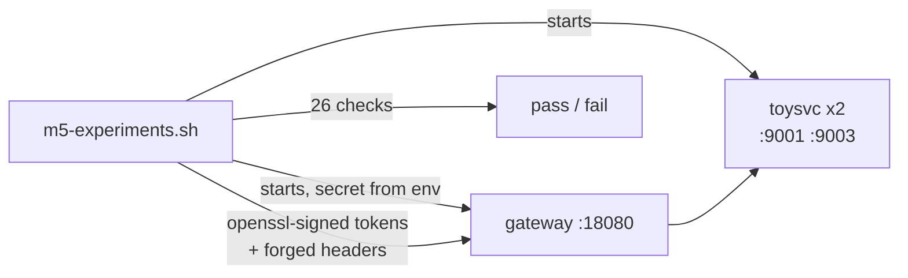

26/26 pass. Startup cases are covered too: the gateway refuses to start with the
secret unset or under 32 bytes, naming the variable and the byte count but never
the secret.

---

## 8. What to remember

- **The gateway verifies; the identity provider issues.** The gateway never sees
  passwords.
- **Header stripping and token verification are one mechanism**, not two. The
  token check protects requests that carry a token; stripping protects the ones
  that don't. Without stripping, the verification protects nothing the upstream
  actually relies on.
- **Never trust the token about itself.** `alg` comes from config, not from the
  token. Same reason for the order of checks in `Key()`: method first.
- **A guard needs a test that fails without it.** The no-`exp` row only means
  something because removing `WithExpirationRequired()` turns it red.
- **HS256 means the gateway can forge tokens; RS256 means it cannot.** That is
  the reason to pay for JWKS.
- **A key source must degrade gracefully.** authsvc being down should hurt only
  the requests that need a key the gateway has never seen.
- **Zero-trust question (open):** should upstreams also verify the token instead
  of trusting `X-User-*`? Trust is simpler (one place holds keys). Verifying
  limits the damage of a bypassed gateway or a mis-routed internal call. Know
  both sides for the review.
